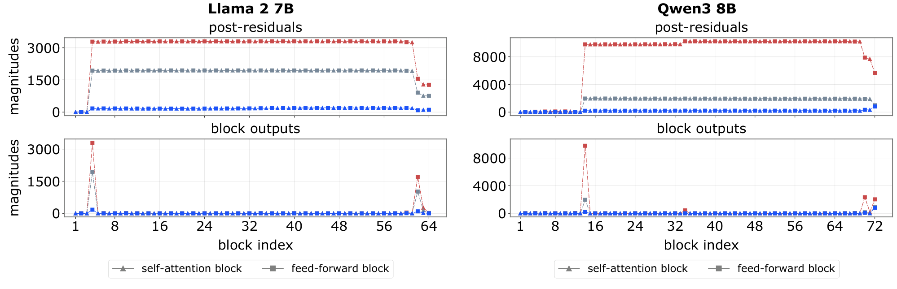
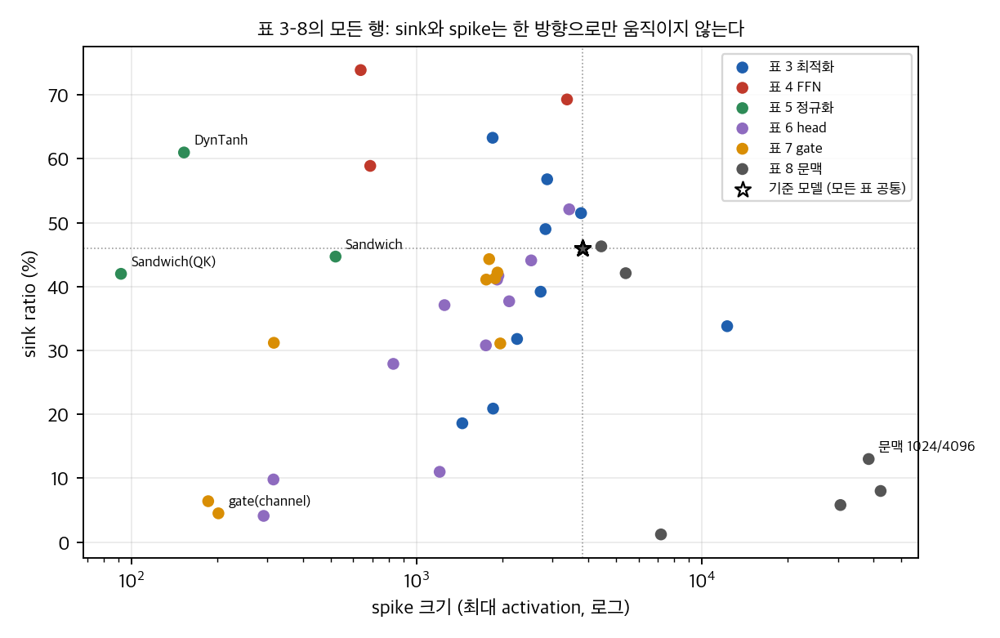
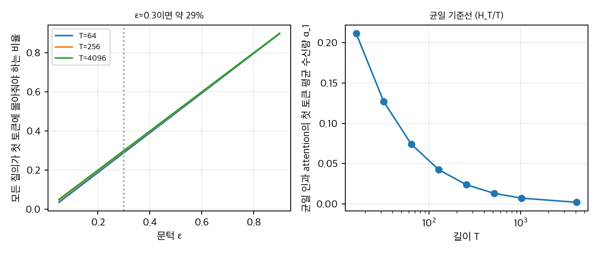
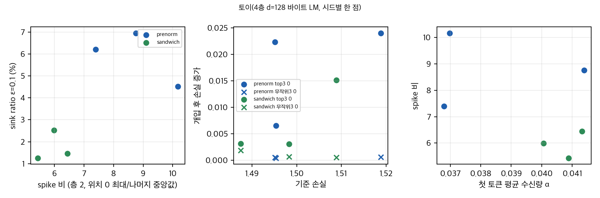

# Massive activation과 attention sink는 정말 따로 끌 수 있나

Llama 계열 LLM에서는 첫 토큰의 몇 채널에 수천 크기의 activation(massive activation, 논문 용어 spike)이 생기고, 같은 토큰이 attention을 끌어갑니다(attention sink). Sun et al.(ICML 2026)은 이 동시 출현이 pre-norm 구조가 이어 주는 우연이라고 주장합니다. 이 글은 그 주장의 근거를 다시 따라가 본 기록입니다. 논문 규모 학습과 사전학습 가중치 측정은 하지 않았고, 공식 코드는 읽기만 했습니다.

## 논문이 한 것

7B Llama를 DCLM 100B 토큰으로 처음부터 학습하는 실험을 정규화, FFN, head 차원, gate, 문맥 분포를 바꿔 여러 번 하고(표 3–8), perplexity, sink ratio, 최대 activation 크기를 비교합니다. 핵심 결과는 표 5입니다. Sandwich norm이나 DynamicTanh를 쓰면 spike가 3,818에서 520, 153으로 줄지만 sink ratio는 44.7%, 61.0%로 남습니다.

*그림: 논문 그림 1. 저자 작성, CC0 1.0, 출처 arXiv:2603.05498. 초기 한두 블록이 주입한 값이 잔차로 유지되다가 후반 블록이 상쇄합니다.*

## 근거가 얼마나 단단한가

표 3–8의 40개 비기준 행은 모두 한 번 학습한 결과이고 모든 표가 같은 기준 모델(perplexity 10.1, sink 46.0%, spike 3,818)을 공유합니다. 오차와 시드 보고가 없고, perplexity는 소수 첫째 자리까지라서 0.1 차이는 반올림 해상도 수준입니다. 기준과 0.1 이하로 다른 행이 19개입니다.

더 근본적인 문제는 **spike의 정의가 없다**는 것입니다. 논문도 공개 코드도 "massive"의 임계값, 측정 층과 위치를 적지 않았습니다. 표 5의 520이 "억제"인지 판단할 기준이 없습니다. 공개 저장소는 §4의 학습 코드만 있고 spike와 sink ratio를 계산하는 코드, §3 분석 코드는 없습니다.

*그림: 우리가 그린 그래프. 표 3–8의 모든 행(논문 표에서 옮김).*

"각각 독립 억제"의 근거를 분류하면 두 군뿐입니다. 정규화 개입(표 5)은 spike만 줄이고, 손실 위치 개입(표 8)은 sink만 줄입니다. 그런데 표 8에서는 sink가 줄 때 spike가 기준의 1.9–11배로 커졌고, head 차원(표 6)과 조건부 gate(표 7)에서는 둘이 함께 줄었습니다. 같은 개입으로 한쪽만 켜고 끄는 쌍은 없습니다.

## sink ratio가 세는 것

논문의 sink ratio는 ε=0.3, T=64에서 "첫 T/2 위치 중 평균 받은 attention이 0.3을 넘는 head의 비율"입니다. 인과 마스크 때문에 첫 토큰은 질의 1에서 attention 1을 받으므로, 모든 질의가 첫 토큰에 비율 f를 쏟는 head의 수신량은 (1+(T−1)f)/T입니다. 0.3을 넘으려면 f가 T=64에서 0.289입니다. 즉 "평균 약 29%를 한 위치에 쏟는 head"를 세는 지표이고, ε와 T의 민감도는 논문에 없습니다.

*그림: 우리가 그린 그래프. 왼쪽은 ε별 필요한 몰아주기 비율, 오른쪽은 균일 인과 attention의 첫 토큰 수신량 H_T/T.*

표 8은 손실을 위치 1,024 이후에서만 계산한 모델의 sink가 사라졌다고 보는데, 같은 T=64 지표로 첫 64 위치를 잽니다. 그 위치는 학습 신호를 받은 적이 없어서, 하락이 sink의 소멸인지 평가 구간 때문인지 이 표만으로는 구분되지 않습니다(우리 추정).

## 식과 설정의 오류

- **식 (21):** 논문은 `λ⋆(s⋆ᵀh̃)² = λ⋆ √d cos(s⋆,h̃)`라고 쓰지만 RMSNorm 때문에 ‖h̃‖=√d이므로 올바른 값은 `λ⋆ d cos²`입니다. d=4096에서 수치로 확인하면 논문 식과 식 (20)의 비가 0.025–0.31입니다. 결론(이차 증폭)에는 영향이 없지만 "이차"라는 서술과 식 (21)이 어긋납니다.
- **표 9:** 학습 스텝 5,000과 배치 2M 토큰은 10B 토큰인데 본문은 100B입니다. 공개 config는 50,000 스텝입니다.
- **"QKNorm" 변형(표 5):** 공개 코드에서는 블록 입력 정규화가 전부 없고 블록 출력에 RMSNorm과 q·k 정규화를 쓰는 구성입니다. DynamicTanh 변형은 최종 RMSNorm이 남아 있습니다.
- **표 4:** 선형 FFN은 2.95B, attention-only는 4.56B 파라미터로 SwiGLU(6.74B)와 크기가 달라서 spike 크기 비교에 크기 효과가 섞입니다.

## 직접 짠 작은 토이

4층, d=128 바이트 단위 LM을 영문 논문 텍스트로 4,000 스텝 학습했습니다(prenorm과 sandwich, 시드 3개씩). **sink는 생기지 않았습니다.** ε=0.3 sink ratio가 모두 0이고 첫 토큰 평균 수신량이 0.04로 균일 기준(0.074)보다 낮았습니다. 약한 spike 유사 구조(위치 0의 최대 값이 나머지 중앙값의 6–10배)는 생겼고, sandwich에서는 절대 크기가 prenorm의 약 1/3이었습니다. 상위 3채널을 0으로 하면 손실이 0.007–0.024 늘고 무작위 3채널은 0.0005였습니다. 크기가 "massive"(1,000배)에 한참 못 미치고 sink가 없어서 논문의 가설을 시험한 것은 아닙니다.

*그림: 우리가 그린 그래프. 시드별 한 점.*

## 인용할 때

step-up/step-down 구조(표 1, 그림 1·7)와 위치 0의 보편성(표 2)은 7개 모델에서 일관됩니다. 정규화·head 차원의 효과는 방향은 설득력 있지만 시드 1개, spike 정의 없음이라는 단서를 붙여야 합니다. 식은 (20)을 쓰고 (21)은 쓰지 마세요.

## 자료

- [통합 리포트 PDF](report/report_public.pdf)
- [01. 논문 분석: The Spike, the Sparse and the Sink](analysis/01_paper_analysis.md)
- [02. 계보와 관련 연구](analysis/02_prior_work.md)
- [03. 정의·식 검산, 표 재계산, 인과 주장의 근거](analysis/03_analysis.md)
- [04. 논문 ↔ 공식 코드 대조](analysis/04_code_verification.md)
