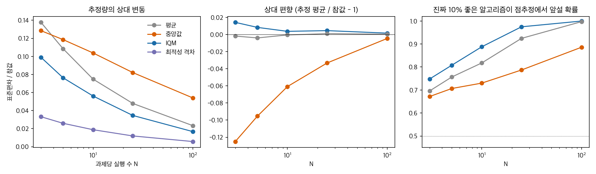
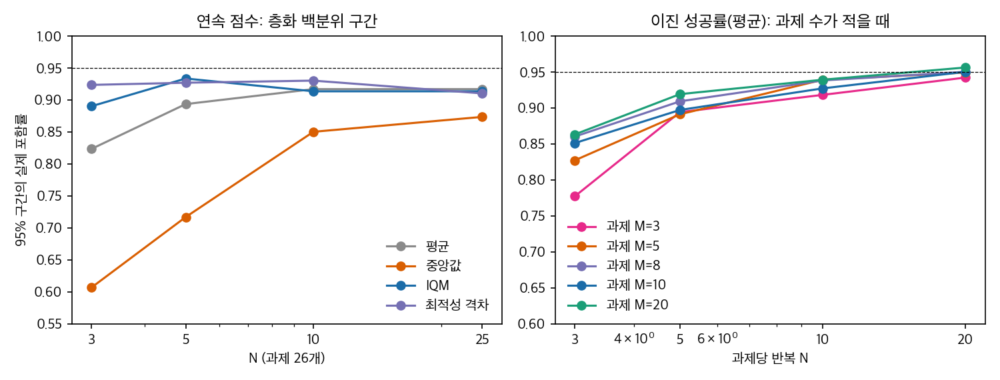
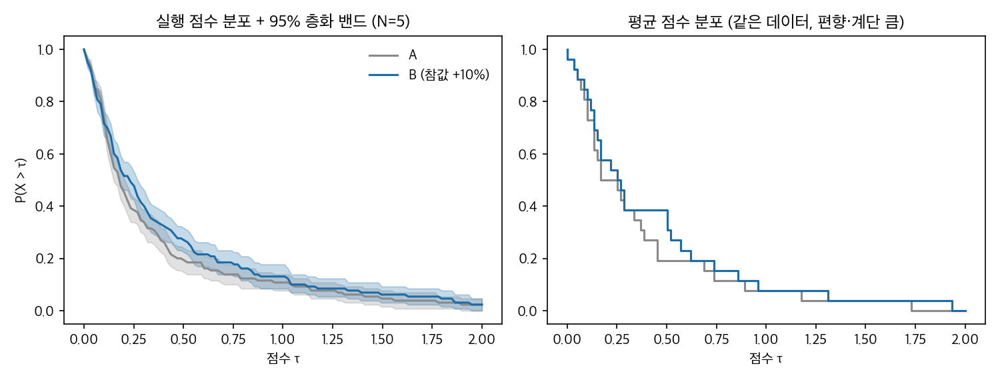

# IQM과 층화 부트스트랩을 직접 구현해 보면

Agarwal 등(NeurIPS 2021, Outstanding Paper)은 딥 RL 벤치마크가 과제당 3–10회 실행만 돌리고 평균·중앙값의 점추정만 보고하는 관행을 비판하고, 소수 실행에서도 쓸 수 있는 보고 방식을 처방합니다. 이 글은 그 도구를 numpy와 scipy로 직접 짜서(신경망이 없는 통계 방법이라 PyTorch를 쓰지 않았습니다) 식을 유도해 검산하고, 직접 만든 토이 세계에서 핵심 주장을 확인한 기록입니다. 코드 실행이나 LLM 호출은 없고, 공식 라이브러리 `rliable`은 정적으로만 읽었습니다.

## 논문이 처방하는 것

과제 M개, 과제당 실행 N개의 점수 `scores[run, task]`가 있을 때 네 가지를 보고합니다.

- **IQM**: 모든 점수를 모아 위아래 25%를 버린 평균. 평균(0% 절사)과 중앙값(거의 50% 절사) 사이.
- **층화 부트스트랩 구간**: 과제마다 실행을 독립적으로 복원추출해 지표의 분포를 얻고 2.5–97.5 백분위를 구간으로 씁니다.
- **성능 프로필**: 점수가 τ보다 큰 실행의 비율을 τ의 함수로 그리고 점별 구간을 붙입니다.
- **개선 확률** P(X>Y): 과제별 Mann–Whitney U를 NK로 나눠 과제 평균을 냅니다.

## 식 검산에서 나온 것

- IQM, 평균, 최적성 격차는 모두 성능 프로필의 면적입니다. IQM = 2∫ clip(F(τ)−0.25, 0, 0.5) dτ를 유도했고, 경험 분포에서 n이 4의 배수일 때 정확히 성립함을 테스트로 확인했습니다.
- 논문 본문은 IQM이 "⌊NM/2⌋개"를 평균낸다고 쓰지만 실제 규칙(양끝 ⌊0.25n⌋ 절사)은 n이 4의 배수일 때만 같습니다. 결론에는 영향이 없는 표기 차이입니다.
- 층화 부트스트랩은 플러그인 분산 때문에 표준오차가 √((N−1)/N)배로 줄어, 정규 근사 포함률이 N=3에서 0.89, N=5에서 0.92입니다. 논문이 그림 6 설명에서 "3회는 과소포함"이라고 한 현상의 이유입니다.
- 실행 점수 분포는 불편이고 분산이 (1/(M²N)) Σ F_m(1−F_m)입니다. 토이에서 0.000934 대 공식 0.000940으로 맞았고, 과제 평균 점수의 분포는 편향 +0.055와 2.8배 큰 분산을 보였습니다.
- 개선 확률이 0.75를 넘으려면 10%가 아니라 약 +86% 향상이 필요합니다(로그정규 토이의 닫힌 식, 시뮬레이션과 일치).

## 토이 세계에서 확인한 것

26개 과제, 과제 난이도가 치우친 로그정규 점수입니다(논문 데이터가 아니라 직접 만든 분포이므로 크기가 아니라 방향을 봅니다).

- IQM의 상대 표준편차가 중앙값과 평균보다 모든 N에서 작습니다(N=3에서 0.099 대 0.129, 0.138). 표본 중앙값은 N=3에서 참값보다 12.5% 낮게 편향됩니다.
- 참으로 10% 더 좋은 알고리즘이 점추정에서 앞설 확률은 N=3–5에서 중앙값 67–71%, IQM 75–81%입니다. 같은 알고리즘 둘을 5회씩 돌리면 중앙값으로 10% 넘는 "개선"이 58%에서 나옵니다.

- 명목 95% 백분위 구간의 실제 포함률은 IQM이 N=5–25에서 0.91–0.93입니다. 중앙값 구간은 N=3에서 0.61, N=25에서도 0.87로 크게 모자랍니다. 논문의 "N=10이면 좋다"는 이 토이에서 IQM에는 대략, 중앙값에는 맞지 않았습니다.
- **논문이 다루지 않은 영역**: 이진 성공률에서는 과제 수 M을 늘려도 N=3의 포함률이 0.78–0.86에 머뭅니다. 또 풀링된 이진 점수의 IQM은 clip((r−0.25)/0.5, 0, 1)로 성공률 25% 이하에서는 항상 0, 75% 이상에서는 항상 1이라 쓸 수 없습니다.

## 공식 라이브러리와 후속 문헌

- `rliable`의 IQM(`trim_mean`, 축을 펴서 25% 절사), 최적성 격차, 프로필, Mann–Whitney 개선 확률, 백분위 구간은 이 구현과 계산이 같습니다. 반복 수 기본값은 집계 50,000, 프로필 2,000입니다. 정적으로 읽은 바로는 `random_state` 인자가 있어도 인덱스를 전역 `np.random`에서 뽑아 시드 재현성이 의심되는데, 실행해 확인하지 않았습니다. 논문 각주의 m/n 부트스트랩은 라이브러리에 없습니다.
- 후속 RL 논문들이 IQM과 95% 구간을 채택했습니다. 한편 Patterson 등(JMLR 2024)은 IQM이 드문 치명적 실패를 가릴 수 있고 치우친 분포에서는 백분위 부트스트랩에 20–30회가 필요할 수 있다고 단서를 붙입니다.
- 논문이 약속한 개별 실행 점수 버킷(`gs://rl-benchmark-data`)은 2026-11-23 현재 논문 데이터가 없고 무관한 웹 문서만 있어, 논문 그림은 다시 계산하지 못했습니다.

## 이 저장소의 다른 분석과의 관계

에이전트 평가의 반복 실행 변동(`agentic_eval_randomness`), temperature 0의 비결정성(`llm_nondeterminism`), 단일 실행 어블레이션의 잡음(`swe_agent`)이 모두 "실행 수가 적을 때 점추정을 믿을 수 있는가"의 LLM판입니다. 이 논문의 도구는 그 질문에 구간으로 답하되, 문항이 이진이면 위의 한계가 그대로 적용됩니다.

## 한 줄 요약

소수 실행 평가에서 점추정 대신 구간과 IQM을 쓰는 처방은 방향이 맞고 구현도 간단하지만, 백분위 구간은 명목보다 좁고(특히 N≤5) 이진 결과와 과제 수가 적은 영역은 이 논문의 범위 밖입니다.

## 자료

- [최소 구현](analysis/minimal_impl.py)
- [01. 논문 분석: Deep RL at the Edge of the Statistical Precipice](analysis/01_paper_analysis.md)
- [02. 계보와 관련 연구](analysis/02_prior_work.md)
- [03. 식 유도 검산과 최소 구현으로 확인한 것](analysis/03_analysis.md)
- [04. 주장 검증(C1–C9)과 공식 라이브러리 대조(D1–D10)](analysis/04_claim_verification.md)
