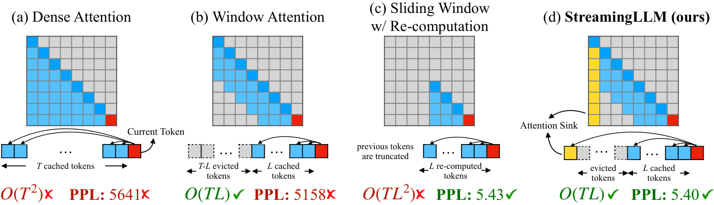
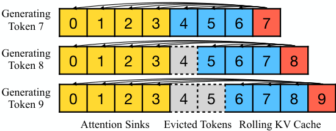
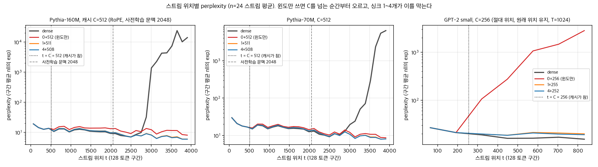
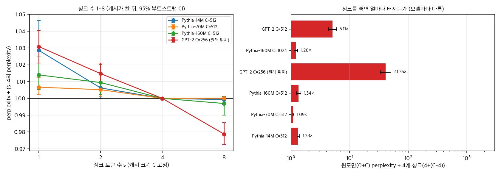
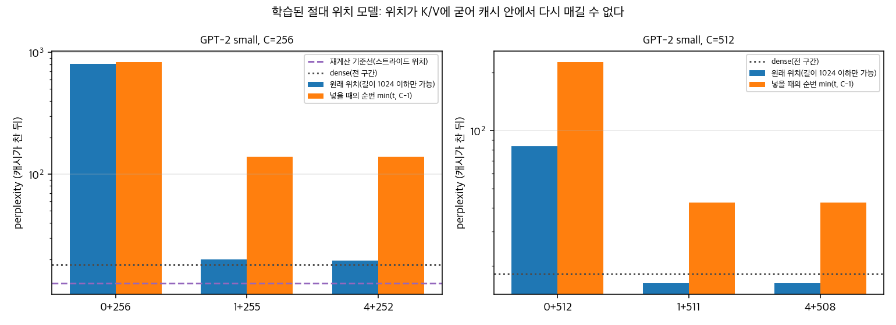
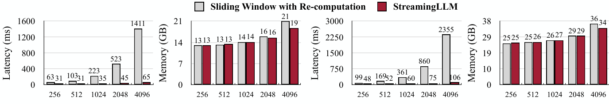
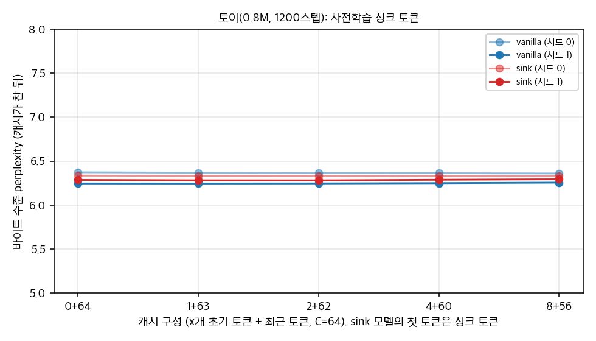

# StreamingLLM의 롤링 KV 캐시를 직접 짜서 확인한 것

StreamingLLM(Xiao et al., ICLR 2024)은 사전학습된 LLM의 KV 캐시를 "맨 앞 몇 토큰 + 최근 윈도"로 고정하면 파인튜닝 없이 사전학습 길이를 넘는 스트림을 처리할 수 있다고 주장합니다. 이 글은 그 방법을 PyTorch로 직접 짜서(`minimal_impl.py`, 테스트 22개) 논문의 정성적 주장이 어떤 조건에서 성립하는지 본 기록입니다. 논문의 Llama-2, PG19, A6000 결과를 재현한 것이 아니라, 로컬에 있는 소형 공개 모델(Pythia-14M/70M/160M, GPT-2)과 pile-10k로 같은 질문을 던졌습니다. GPU 지연과 공식 코드 실행, 사전학습은 하지 않았습니다. 논문 그림 1, 4, 10은 arXiv 라이선스(CC BY 4.0)에 따라 그대로 실었고 나머지 그래프는 직접 그렸습니다.

## 방법

*논문 그림 1(CC BY 4.0). (b) 윈도 attention은 첫 토큰이 빠지면 무너지고, (c) 재계산은 정확하지만 O(TL²), (d) StreamingLLM은 싱크 + 최근 윈도로 O(TL).*

softmax는 합이 1이어야 하므로 쓸 곳이 없는 attention을 어딘가에 버려야 하고, 모든 이후 토큰에 보이는 초기 토큰이 그 자리가 된다는 것이 논문의 설명입니다(3.1절). 그래서 초기 토큰이 캐시에서 빠지면 분모가 달라져 분포가 무너집니다. 해법은 처음 s개(기본 4)를 남기고 최근 윈도를 붙이되, **위치를 원문이 아니라 캐시 안 순번으로** 매기는 것입니다.

*논문 그림 4(CC BY 4.0). 토큰 8과 9를 만들 때 4, 5번이 밀려나고 캐시 안 위치는 0, 1, 2, ...로 다시 매겨집니다.*

구현(`minimal_impl.py`)은 두 가지입니다.

- `RollingKVCache`: 토큰을 하나씩 넣고, 층마다 **회전 전의 K**와 V를 쌓고, 크기가 C = s + w를 넘으면 싱크 뒤의 가장 오래된 항목을 뺍니다. 매 단계 캐시 안 순번으로 키를 회전합니다(논문 3.2절 그대로).
- `attend()`: 같은 일을 한 번에 계산하는 병렬 형태. 질의 t는 싱크 [0, s)와 윈도 [max(s, t−w+1), t]를 보고, 윈도 키는 원래 위치로 회전해도 상대 거리가 캐시 안 거리와 같고(RoPE는 상대 위치만 봄), 싱크 키는 위치 0..s−1, 질의는 min(t, C−1)로 회전합니다. 이 덕에 길이 4096 스트림 24개를 한 번에 돌릴 수 있고, 두 구현이 같은 로짓을 내는지 테스트(float64 1e-9)와 실제 가중치(float32 상대 1e-4)로 확인했습니다.

`MiniLM`은 Pythia(GPT-NeoX: RoPE 일부 차원, 병렬 잔차)와 GPT-2(학습된 절대 위치)를 한 코드로 돌리며 HF 로짓과 일치합니다(GPT-2 1e-9, Pythia는 HF의 float32 RoPE 각도 때문에 1e-5 수준).

## 실험 설정

pile-10k 문서를 시드 0 순서로 이어 붙여(문서 뒤 EOS) 길이 4096 스트림 24개(GPT-2는 1024와 2048)를 만들고, 각 스트림은 문서 첫머리에서 시작합니다. 캐시가 차기 전(t < C)에는 모든 방법이 dense와 같고, 그 뒤 구간의 perplexity로 방법을 비교합니다. 신뢰구간은 스트림 단위 부트스트랩, 방법 간 비교는 스트림 짝지은 부호 뒤집기 검정 뒤 Holm 보정입니다. 분산의 원천은 문서(스트림) 표집뿐이고 시드는 1개입니다.

## 결과 1: 윈도만 쓰면 항상 나쁘지만 크기는 모델이 정한다

윈도만(빨강)은 캐시가 차는 순간부터 오르고, 싱크 1개나 4개(주황, 파랑)는 그것을 막습니다. Pythia의 dense(회색)는 사전학습 문맥 2048을 넘으면 무너집니다(160M: 12 → 384).

- 모든 설정에서 24개 스트림 전부 윈도만이 나빴고 Holm p ≤ 0.004입니다. 그러나 크기는 Pythia-70M 1.09배, 14M 1.33배, 160M 1.34배(C=512), GPT-2 5.1배(C=512)·41배(256)·약 80배(128)입니다. 논문 표 2 안에서도 Falcon-7B 1.5배, Pythia-12B 1.8배, MPT-7B 31배, Llama-2-7B 350배라 "무너진다"의 크기는 모델 의존입니다.
- **싱크는 1개로 대부분 충분했습니다.** GPT-2는 1개와 4개가 구분되지 않고, Pythia는 2–3% 안입니다(14M +0.032 nat, p = 0.0016; 160M +0.019 nat, p = 0.041; 70M +0.006, p = 0.46). 8개가 4개보다 낫다는 증거는 없습니다. 논문 표 2의 "4개 필요, 1~2개 부족"은 Llama-2-7B(11.88 → 9.59)의 값입니다.
- 윈도가 클수록 싱크를 뺀 손해가 줄어듭니다(Pythia-160M 1.53 → 1.34 → 1.20배, C = 256, 512, 1024).
- sink 강도와의 관계는 약합니다. 이 저장소의 다른 분석이 잰 "처음 위치가 받는 attention"(α₁)이 가장 큰 GPT-2(0.355)가 폭발도 가장 크지만, Pythia 세 모델 사이에서는 순서가 맞지 않습니다(n = 4, 순서 확인 이상의 의미 없음).

## 결과 2: 4+윈도는 재계산과 같고, 처음 토큰의 내용은 상관없다

슬라이딩 윈도 + 재계산(윈도마다 위치 0부터 다시 계산)과 같은 위치에서 비교하면 Pythia-70M은 +0.002 nat [−0.008, 0.013], Pythia-160M은 +0.021 nat [0.003, 0.042](Holm 0.19)입니다. 동등 검정은 하지 않았으므로 "0.04 nat 이내"로 읽어야 합니다. 논문 표 1처럼 처음 4토큰을 줄바꿈으로 바꿔도 모든 설정에서 ±0.032 nat 이내라 싱크의 내용이 아니라 위치가 중요하다는 해석과 맞습니다(단 입력만 바꾼 것이라 직접 증명은 아님).

## 결과 3: 위치를 캐시 안 순번으로 매기는 것은 언제 결정적인가

논문은 이것이 "결정적"이라고 쓰지만, 질의만 원래 위치 t로 회전하는 소거(싱크 키는 위치 0..s−1 그대로)를 해 보면 조건이 붙습니다.

| 모델, 싱크 4 | 캐시 안 위치: t < 2048 / t ≥ 2048 | 원래 위치: t < 2048 / t ≥ 2048 |
|---|---|---|
| Pythia-70M | 16.39 / 9.94 | 16.41 / 18.96 |
| Pythia-160M | 11.63 / 7.35 | 11.75 / **122.4** |

사전학습 문맥 안(t < 2048)에서는 1% 안팎이고, 문맥을 넘으면 질의-싱크 거리가 학습 범위를 벗어나 무너집니다. 즉 위치 재배정은 sink 메커니즘이 아니라 **길이 외삽 문제의 해결**입니다.

학습된 절대 위치(GPT-2)에서는 위치 임베딩이 입력에 더해져 K와 V에 굳기 때문에 캐시 안에서 순번을 다시 매길 수 없습니다. 가능한 것은 원래 위치를 유지하는 것(길이 1024 이하만)과 넣을 때의 순번 min(t, C−1)을 쓰는 것(우리 제안)뿐입니다. 원래 위치에서는 RoPE와 같은 그림이지만(싱크 1개가 805 → 20으로 막음), 순번 위치에서는 폭발은 막아도(835 → 139) 재계산(12.7)에서 멀고, T = 2048에서는 재계산보다 약 18배(+2.88 nat) 나쁩니다. 이 방법은 위치를 attention 계산 때 붙이는 모델(RoPE, ALiBi)을 전제로 합니다.

## 논문 숫자 재계산

*논문 그림 10(CC BY 4.0). 왼쪽 두 그래프가 Llama-2-7B, 오른쪽 두 그래프가 13B.*

- 막대 숫자로 속도비를 다시 계산하면 13B 캐시 4096에서 2355/106 = **22.22배**로 초록의 "최대 22.2×"와 일치합니다(7B는 21.7배). 재계산 지연은 aL + bL² + c에 잘 맞고(최대 잔차 4.8 ms) 4096에서 2차 항이 54%, StreamingLLM 쪽은 선형(기울기 0.0092 ms/캐시 토큰, 절편 26.8 ms)입니다. A6000 지연 자체는 재현하지 않았습니다.
- **표 2와 표 6의 Falcon-7B 4+2044가 12.12 대 12.84로 다릅니다.** 같은 구성, 같은 데이터이고 v1에도 같습니다. 표 6 Falcon 행은 4+508과 4+2044가 모두 12.84이고 굵게 표시된 최솟값(12.34)이 표 2의 12.12보다 큽니다.
- 표 3(사전학습 싱크 토큰)은 PG19 첫 표본 1개, 시드 1개라 구간이 없고, 표 4의 7개 벤치마크 차이(+0.3~+1.0pt)는 모두 표본 오차 안입니다(문항 수는 논문에 없어 표준 분할을 가정, Holm 후 p = 1).
- 표 7에서 정확도가 0이 되는 거리는 4개 캐시 크기 모두 23×줄 수 > 캐시와 정확히 일치합니다. 캐시 밖 정보는 쓸 수 없다는 논문 자신의 한계입니다.

## 사전학습 싱크 토큰: 확인하지 못했습니다

모든 학습 샘플 앞에 학습 가능한 싱크 토큰 하나를 붙이면 그 토큰만 남겨도 된다는 3.3절 주장을, 바이트 수준 0.8M 모델 1200스텝 토이로 시험했습니다.

이 규모에서는 싱크가 아예 생기지 않았습니다(윈도만과 싱크 8개의 차이 0.5% 이내, 첫 토큰이 받는 attention이 균일 기준선과 같음). 두 변형이 같은 값이라 주장을 시험할 수 없었고, 조건 미달로 읽어야 합니다(증거도 반증도 아님). 공식 저장소에도 사전학습 코드와 체크포인트가 없어 독립 재현이 불가능합니다.

## 한계

- 소형 모델 4개, Pile 스트림, 문서 순서 시드 1개, 스트림 24개입니다. Llama-2급 모델, PG19, 4M 토큰 규모는 확인하지 않았습니다.
- 동등성(재계산과 같음)은 동등 검정 없이 차이의 구간으로만 봤습니다.
- Pythia-160M과 GPT-2(T=2048)는 CPU, 나머지는 MPS에서 돌렸습니다(float32, 가중치 같음).
- 후속 문헌(LM-Infinite, H2O, DuoAttention 등)은 초록 수준으로만 읽었습니다.

## 재현

`analysis/`의 `minimal_impl.py`, `test_minimal_impl.py`, `run_streaming_ppl.py`와 결과 json을 보세요. 모델과 데이터는 로컬 캐시만 썼고, 새로 받은 것이 없습니다.

## 자료

- [최소 구현](analysis/minimal_impl.py)
- [01. 논문 분석: Efficient Streaming Language Models with Attention Sinks (StreamingLLM)](analysis/01_paper_analysis.md)
- [02. 계보, 구성 요소의 출처, 이 저장소의 다른 분석과의 관계](analysis/02_prior_work.md)
- [03. 분석: 롤링 KV 캐시를 직접 짜서 스트리밍 perplexity로 논문 주장을 확인](analysis/03_analysis.md)
- [04. 주장 검증: 이후 문헌과 우리 측정이 확인·수정·반박한 것, 공식 코드 정적 대조](analysis/04_claim_verification.md)
