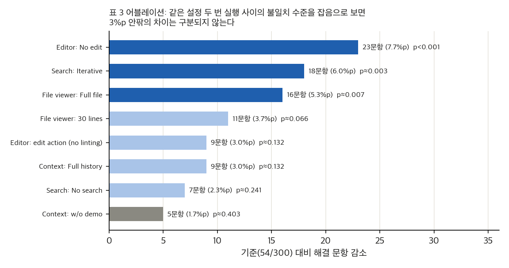
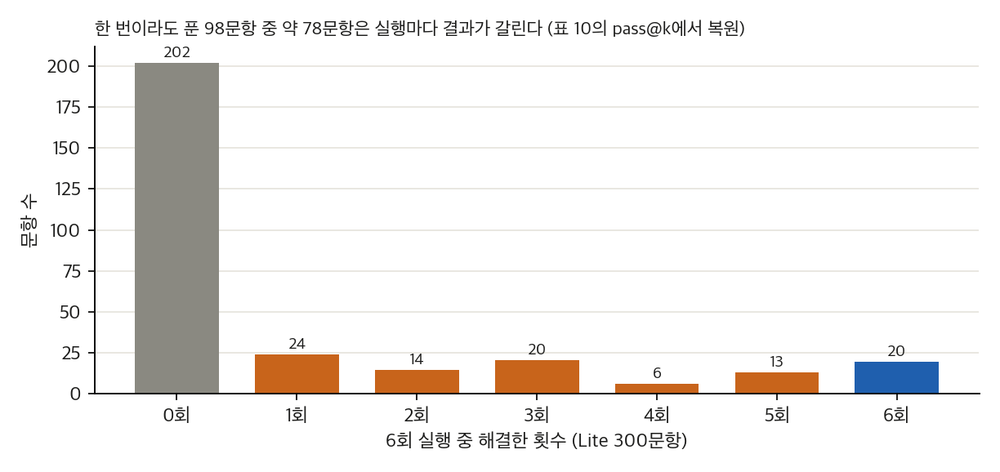
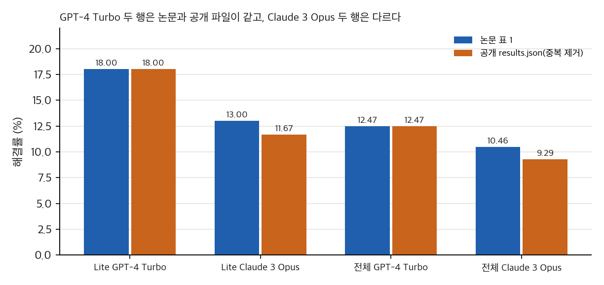

# 03. 재계산과 통계 검정

모든 수치는 `analysis/recompute_tables.py`가 계산해 `analysis/recompute_results.json`에 저장한다. 입력은 논문 표의 숫자와, SWE-bench/experiments 저장소의 공개 결과 파일 `evaluation/{lite,test}/20240402_sweagent_{gpt4,claude3opus}/results/`(문항별 해결 목록, 4세트 합쳐 0.7 MB)이다. 패치 실행, Docker, LLM 호출은 하지 않았다. 구간은 모두 Wilson 95%다.

## 0. 먼저 알아둘 점: 무엇이 문항별로 공개되어 있나

- **있음:** 본 실행 4개(Lite와 전체, GPT-4 Turbo와 Claude 3 Opus)의 해결 인스턴스 목록. 그래서 모델 간 짝지은 검정과 논문 표와의 대조가 된다.
- **없음:** 표 3 어블레이션 변형들, 표 10의 6회 실행, Shell-only와 RAG의 문항별 결과. 이 비교들은 주변 합(해결 수, 표본 수)만으로 가능한 McNemar 범위를 계산하고, 표 10의 pass@k로 실행 간 불일치를 추정해 보완했다.
- 궤적(trajectory)은 S3에 있다는 안내만 확인했고 내려받지 않았다(`04` §6).

## 1. 표 1: k/n 정합과 구간 (모두 정수 k/n으로 맞음)

| 설정 | 보고값 | k/n | 95% 구간 |
|---|---|---|---|
| SWE-agent GPT-4 Turbo, 전체 | 12.47 | 286/2294 | 11.18–13.88 |
| SWE-agent Claude 3 Opus, 전체 | 10.46 | 240/2294 | 9.28–11.78 |
| RAG GPT-4 / Opus, 전체 | 1.31 / 3.79 | 30 / 87 | 0.92–1.86 / 3.08–4.65 |
| SWE-agent GPT-4 Turbo, Lite | 18.00 | 54/300 | 14.07–22.74 |
| SWE-agent Claude 3 Opus, Lite | 13.00 | 39/300 | 9.66–17.28 |
| Shell-only GPT-4 Turbo, Lite (데모 있음 / 없음) | 11.00 / 7.33 | 33 / 22 | 7.94–15.05 / 4.89–10.85 |
| RAG GPT-4 / Opus, Lite | 2.67 / 4.33 | 8 / 13 | 1.36–5.17 / 2.55–7.27 |

전체 2,294문항에서의 구간은 약 ±1.4%p, Lite 300문항에서는 약 ±4%p이다. SWE-agent 대 RAG의 차이(Lite 54 대 8, 전체 286 대 30/87)는 구간이 겹치지 않아 표본 오차로 설명되지 않는다. 모델 간(GPT-4 대 Opus)과 Lite의 설정 간 비교는 아래에서 따로 본다.

## 2. 본문 주장의 산술

| 주장(위치) | 재계산 | 판정 |
|---|---|---|
| Shell-only 대비 "64% 상대 증가"(§5) | 18.00/11.00 − 1 = 63.6% (둘 다 데모 있음) | 맞음 |
| RAG 대비 "6.7배"(§5) | 18.00/2.67 = 6.74 | 맞음 |
| RAG 대비 비용 "8–13배"(§5) | 1.67/0.13 = 12.8, 2.18/0.25 = 8.7 | 맞음 |
| 서론의 "기본 셸 에이전트보다 10.7%p 더 푼다" | 18.00 − 7.33 = 10.67 | **조건이 맞지 않는 비교.** 18.00은 데모를 쓴 SWE-agent, 7.33은 데모를 쓰지 않은 Shell-only. 같은 조건끼리는 데모 있음 18.00 − 11.00 = **7.0%p**, 데모 없음 16.3(표 3) − 7.33 = **9.0%p** |

짝지은 검정은 문항별 결과가 없어 불가능하다. 주변 합만으로의 McNemar 범위: 데모 있음끼리(54 대 33)는 최소 불일치일 때 p ≈ 1e-6, **최대 불일치일 때 p = 0.031**. 데모 없음끼리(49 대 22)는 p ≤ 0.0018. 즉 "SWE-agent가 Shell-only보다 낫다"는 결론은 어느 경우에도 유지되지만(최악도 p = 0.03), 크기는 7%p로 읽어야 한다.

## 3. 표 3 어블레이션: 차이가 표본 오차를 넘는가

표 3의 각 칸은 **한 번의 실행**이고 변형끼리 같은 300문항을 쓴다. 기준(18.0% = 54/300)은 표 1의 본 실행과 같은 실행이며, 6회 평균 17.94%와 거의 같다(기준 칸이 유리하게 고른 값은 아니다).

비짝지은 Wilson 구간은 변형마다 ±4%p라 모두 서로 겹친다. 같은 문항을 쓴 짝지은 비교이므로 이 구간으로 판단하면 안 되고, 두 가지로 따져 본다.

(A) **주변 합만으로 가능한 McNemar의 범위.** 불일치 쌍이 가장 적은 경우(차이만큼만 한 방향)와 가장 많은 경우.
(B) **같은 설정의 두 실행 사이 불일치를 잡음으로 둔 근사.** 표 10(§5)에서 두 실행 사이 불일치 문항 수의 기대값은 약 35.7쌍이므로, 변형이 효과가 없을 때 해결 수 차이의 표준편차는 약 √35.7 ≈ 6.0문항(2.0%p)이다. 이 값으로 정규 근사 z와 p를 낸다.

| 변형 | 해결 | 기준 대비 | (A) McNemar p 범위 | (B) z | (B) p |
|---|---|---|---|---|---|
| 편집 도구 없음 | 31 | −23문항(−7.7%p) | 2e-7 – 0.017 | 3.85 | <0.001 |
| 반복(iterative) 검색 | 36 | −18(−6.0%p) | 8e-6 – 0.073 | 3.01 | 0.003 |
| 파일 전체 보기 | 38 | −16(−5.3%p) | 3e-5 – 0.117 | 2.68 | 0.007 |
| 창 30줄 | 43 | −11(−3.7%p) | 0.001 – 0.31 | 1.84 | 0.066 |
| **linting 없음**(edit만) | 45 | −9(−3.0%p) | 0.004 – 0.42 | 1.51 | **0.13** |
| 전체 기록(접지 않음) | 45 | −9(−3.0%p) | 0.004 – 0.42 | 1.51 | 0.13 |
| 검색 도구 없음 | 47 | −7(−2.3%p) | 0.016 – 0.55 | 1.17 | 0.24 |
| 데모 없음 | 49 | −5(−1.7%p) | 0.06 – 0.69 | 0.84 | 0.40 |

읽는 법:

- **편집 도구 없음, 반복 검색, 파일 전체 보기**의 하락(5%p 이상)은 (B)에서도 유의하다. "큰 인터페이스 차이는 성능을 가른다"는 주장은 표 3으로 지지된다.
- **linting 가드레일의 효과(3.0%p)는 (B)에서 유의하지 않다**(p ≈ 0.13). 원칙 4("가드레일이 회복을 앞당긴다")의 직접 근거로 쓰이는 칸인데, 이 단일 실행 비교만으로는 잡음과 구분되지 않는다. 방향은 일관적이고(편집 후 실패 회복이 어렵다는 §5.2 분석과 같은 방향) 효과가 없다고 말할 수도 없다. 그러나 표 3 하나가 증거는 아니다.
- (B)는 표 10의 관측 SD(0.54%p)를 쓰면 더 낙관적이 된다. 그 경우 두 실행 차이의 SD는 약 2.3문항이라 데모 없음(5문항)만 z = 2.2로 겨우 걸리고 나머지는 모두 z > 3이다. 두 가정의 차이가 큰 이유가 §5에 있다. 어느 쪽이 맞는지는 표 10의 실행 수(6)가 적어 단정할 수 없다.
- 이 비교는 **같은 300문항**에서의 비교다. 문항을 바꿔도 같은 차이가 나는지(문항 표집 오차)는 이 자료로 볼 수 없다. 짝지은 설계라 문항 표집 오차가 줄어들긴 하나 Lite는 django(114)와 sympy(77)가 63%를 차지한다(표 6).
- 단계별 최적화의 문제: 이 설정들은 개발 분할의 질적 관찰과 격자 탐색으로 골랐고(§2, §4), 기준이 선택된 설정이므로 기준에서 벗어나면 대체로 떨어지는 것이 예상된다(승자의 저주). 그래서 하락 크기를 "각 요소의 독립 기여"로 읽으면 안 된다.

## 4. HumanEvalFix (표 2)

- 값이 164의 정수 비율이 아니다: Python 87.7(가장 가까운 144/164 = 87.80), JS 89.7(147/164 = 89.63), Java 87.9(144/164 = 87.80). 오차는 0.07–0.11%p로 작지만 정수 k/164로 설명되지 않는다. 모두 정수 분모로 맞추려면 n이 389–398쯤이어야 하는데 이는 164의 배수가 아니다. 여러 번 실행의 평균인지 다른 계산인지 논문이 적지 않았다.
- 본문 5절은 "88.3% pass@1"이라 쓰고, 표 2는 Python 87.7, 세 언어 평균은 88.43이다. 초록은 87.7%다. 인용할 때는 표 2의 언어별 값을 쓴다.
- 구간(n = 164, 정수화해서): 약 82–92%, 84–93%, 82–92%. 비교 모델(WaveCoder 57.9 등)은 Yu et al.의 보고값을 그대로 가져온 것이라 프롬프트·설정이 같다는 보장이 없다(표 2 캡션 "scores as reported").

## 5. 실행 간 변동과 pass@k (표 10)

6회 실행(Lite, GPT-4): 52, 54, 54, 56, 52, 55문항(17.33–18.67%). 평균 17.94, 보고된 "±0.49"는 **모집단 SD**(표본 SD는 0.54)다.

표 10의 pass@1–6을 문항별 해결 횟수의 분포로 풀면(7개 연립방정식, 반올림 민감도 확인) 다음과 같다.

| 6회 중 해결 횟수 | 0 | 1 | 2 | 3 | 4 | 5 | 6 |
|---|---|---|---|---|---|---|---|
| 문항 수 | 202 | 24 | 14 | 20 | 6 | 13 | 20 |

(각 칸은 pass@k의 소수 둘째 자리 반올림에 약 ±2–3문항 흔들린다. 4회 칸이 3–9로 가장 크다.)

- 한 번이라도 푼 문항은 98개(pass@6 32.67%)인데, 6번 모두 푼 것은 약 20개뿐이고 **약 78개는 실행마다 갈린다.** 평균 해결률은 안정적(±0.5%p)이지만 문항별 결과는 불안정하다. 이것은 논문 본문도 인정한다("per-instance resolution can change considerably").
- 두 실행 사이의 불일치 문항 수 기대값은 약 36쌍이다. §3(B)의 잡음 크기가 여기서 온다.
- **관측 SD와 일관되지 않는다.** 위 분포에서 문항별 독립 흔들림을 가정하면 한 실행의 해결률 SD는 약 1.41%p여야 하는데 관측은 0.54%p다. 관측 분산이 그 정도로 작을 확률은 p = 0.018(χ², df 5)이다. 가능한 설명은 실행 간 문항 결과가 음의 상관(예: 예산·시간 제한으로 한 실행이 느리면 다른 쪽이 유리)이거나, 6회가 독립이 아니거나(같은 도커 상태 등), 표 10의 값을 다른 식으로 계산한 경우다. 이 분석으로 원인을 가릴 수 없다.
- 이 변동은 `agentic_eval_randomness`가 Verified에서 본 단일 실행 pass@1의 2.2–6.0%p 범위보다 훨씬 작다(다른 벤치마크·모델·스캐폴드라 직접 비교는 아니다).
- 실행 설정은 temperature 0.0(부록 B.1)인데도 문항 결과가 갈린다. `llm_nondeterminism`의 결과와 같은 방향이다.

## 6. 공개 결과 파일과 논문 표의 대조

| 설정 | 논문 표 1 | 공개 results.json(중복 제거) | 일치 |
|---|---|---|---|
| Lite GPT-4 Turbo | 18.00 (54) | 54 | 일치 |
| 전체 GPT-4 Turbo | 12.47 (286) | 286 | 일치 |
| Lite Claude 3 Opus | **13.00 (39)** | **35 (11.67%)** | **불일치** |
| 전체 Claude 3 Opus | 10.46 (≈240) | 213 (9.29%) | **불일치** |

- **Lite Opus: 논문 안에서도 서로 다르다.** 표 1은 13.00%(39개)인데 표 6(저장소별), 표 7(연도별), 표 13(종료 방식)을 합치면 모두 35개(11.67%)다. 공개 파일도 35다. 표 1의 13.00은 v1부터 v3까지 그대로다. 35 쪽이 내적으로 4곳과 일치하므로 13.00이 오류일 가능성이 높다(이유는 확인할 수 없다).
- **전체 Opus: 공개 파일이 중복을 포함한다.** `results.json`의 `resolved`에 241개 항목이 있는데 중복을 빼면 213개다(7개 인스턴스가 최대 5번 등장, 합 28개 초과분). 논문 표 13은 해결 241개(206 + 35)로 중복을 센 값과 같고, 표 1은 10.46%(240개)이며, 같은 저장소의 `resolved_by_time.json`은 213, `resolved_by_repo.json`은 241을 합친다. 종료 방식별 파일(`end_condition_resolved.json`)은 157 + 35 = 192다. **전체 Opus의 해결 수는 공개 파일만으로 확정할 수 없다**(213, 192, 240, 241). 궤적과 평가 로그(S3)를 열어야 판정된다. 표 1의 10.46은 213의 구간(8.16–10.54)의 위쪽 끝에 걸린다.
- GPT-4 Turbo는 모든 항목이 논문과 정확히 일치한다(해결 286, 종료 방식 266 + 20 등). 문항 목록도 중복이 없다.
- 공개 파일에는 2,294문항 중 모델마다 2,266개만 나온다(두 모델의 합집합 2,268, 교집합 2,264). 나머지 약 26–28개는 어느 목록에도 없어 해결이 아닌 것으로 센 것으로 보인다(표 13의 궤적 수도 GPT-4 2,268, Opus 2,004로 2,294보다 적다). 분모가 2,294인지 실제 실행된 수인지 논문이 밝히지 않는다. 12.47%는 286/2294이고 286/2268 = 12.61%다.

### 6.1 모델 간 짝지은 비교 (문항별 결과 이용)

| 비교 | A만 | B만 | 둘 다 | 둘 다 아님 | McNemar p |
|---|---|---|---|---|---|
| Lite: GPT-4(54) 대 Opus(35) | 29 | 10 | 25 | 236 | 0.0034 |
| 전체: GPT-4(286) 대 Opus(213, 중복 제거) | 147 | 74 | 139 | 1,934 | 1.0e-6 |

GPT-4 Turbo가 Opus보다 낫다는 것은 두 분할 모두 유의하다. 논문 표 1의 Opus 수치(Lite 39, 전체 240)를 그대로 쓰면 주변 합만으로의 최대 불일치 p는 Lite 0.146, 전체 0.0496이라, **Lite에서는 논문 수치로 "GPT-4가 Opus보다 낫다"를 보이지 못한다.** 공개 파일의 35개를 쓰면 유의하다. 어느 쪽이든 두 모델의 해결 집합은 겹침이 작다(Jaccard 0.39): 서로 다른 문항을 푼다.

### 6.2 같은 모델의 두 실행 (Lite 실행 대 전체 실행의 Lite 문항)

- **GPT-4:** 두 결과가 완전히 같다(54 = 54, 불일치 0). Lite 결과는 전체 실행에서 Lite 문항만 뽑은 것이지 별도 실행이 아니다.
- **Opus:** 별개 실행이다. Lite 실행 35개, 전체 실행의 Lite 문항 36개로 해결 수는 비슷하지만 겹치는 것은 24개이고 불일치가 23쌍(11 대 12)이다(Jaccard 0.51). 해결 수가 같아도 **무엇을 푸는지가 실행마다 크게 바뀐다**는 §5와 같은 현상이다.

## 7. 표 13과 5.2절 수치

- 해결된 인스턴스의 93.0%가 예산 소진 전에 제출됐다는 본문 수치는 재계산 일치(266/286). 전체 제출 비율 "69.0%"는 1,589/2,294 = 69.3% 또는 1,589/2,268 = 70.1%이고 69.0과 정확히는 맞지 않는다(작은 차이).
- **"제출한 실행의 14.3%가 해결"은 표 13으로 재현되지 않는다.** 266/1,589 = 16.7%다(전체 GPT-4). 같은 문장의 "예산 소진 3.1%"는 20/630 = 3.2%로 거의 맞는다. 14.3%의 출처는 알 수 없다.
- "예산을 늘려도 성능이 크게 오르지 않을 것"이라는 추측: 소진한 678개 실행(전체의 29.9%)의 해결률은 2.9%(20개, 1.9–4.5%)다. 그러나 소진은 이미 막힌 문항에서 생기는 선택 효과라서 인과 증거가 아니다. 예산을 바꾼 대조 실행은 없다. 분포로만 읽는다.
- 편집 실패: 1,185/2,294 = 51.66%(49.6–53.7%)로 일치. "편집 성공 확률 90.5%에서 한 번 실패 뒤 57.2%"는 궤적이 없어 재계산하지 않았다.
- **파일 F1 59.05%(부록 B.9)** 는 공개 `file_f1.json`에서 **Lite GPT-4**(302개 항목)로 재현된다. 전체 GPT-4는 50.94%, Lite Opus는 46.89%다. 본문은 분할을 적지 않았다. 비교 대상 BM25(45.47%)도 분할이 불분명하다. F1 0인 문항이 Lite GPT-4에서 39.4%다.

## 8. 실패 유형 분석 (그림 8, 표 9)

- 비율을 n = 248로 환산하면 99, 30, 58, 32, 5, 6, 12, 6으로 정수가 되고 합이 248이다. 그런데 표 1 기준 Lite 미해결은 300 − 54 = 246개다. 2개 차이의 원인은 논문에 없다(공개 Lite GPT-4 목록에 중복 2개가 있는 것과 관련될 수 있다).
- GPT-4o 자동 분류와 사람 라벨의 일치 "87%"는 15개 중 13개다. 95% 구간은 62–96%다. 범주가 9개이고 비중이 크지 않은 범주는 검증이 사실상 없다. 그림 8의 비율은 자동 라벨에 의존하는 대략적 값으로 읽는다.
- 범주 정의("잘못된 구현"과 "너무 특수한 구현")는 모델의 판단에 달렸고, 판정은 정답 패치를 보고 이루어졌다(§B.4). SWE-bench의 숨은 테스트가 약하면 "너무 특수한 구현"이 실제로는 옳은 수정일 수 있다.

## 9. 하이퍼파라미터 탐색 (표 5)

개발 분할 37개 인스턴스, 설정당 5회 표본의 평균이다. 1문항은 2.7%p이고, 최상위 설정(15.1%)과 2위(14.1%)의 차이 1.0%p는 0.4문항이다. 한 번의 실행 15%의 구간은 7.7–31.1%(n = 37)다. 8개 설정 중 최대를 고른 것이므로 최댓값은 낙관적이다. 선택된 temperature 0.0, 창 100줄, 최근 5개 관찰이 다른 설정보다 낫다는 증거는 약하다. 다만 창 200줄 쪽이 일관되게 낮다(9.2–10.8 대 14.1–15.1, GPT-4)는 경향이 있고, 표 3(Lite)의 30줄과 전체 파일 하락과 같은 방향이다.

## 10. 설정 요약

| 항목 | 값 | 출처 |
|---|---|---|
| 모델 | gpt-4-1106-preview, claude-3-opus-20240229 | §4 |
| temperature / 창 / 기록 | 0.0 / 100줄 / 최근 5개 관찰 | 부록 B.1 |
| 인스턴스당 비용 상한 | $4 (초과 시 편집을 자동 제출) | §4 |
| 반복 | 본 실행 1회, Lite GPT-4만 6회(표 10) | §5, 부록 B.5 |
| 평균 비용(표 1) | GPT-4 \$1.59(전체)·\$1.67(Lite), Opus \$2.59·\$2.18 | 표 1 (정의가 모호함: §4는 "해결된 인스턴스 평균"이라 쓰는데 RAG 행은 전체로 보임) |
| 분모 | 전체 2,294, Lite 300 | §4 |

## 11. 인용 가능성 판정 요약

| 주장 | 재계산 | 판정 |
|---|---|---|
| SWE-agent GPT-4 Turbo가 전체의 12.47%, Lite의 18.00%를 푼다(표 1) | 공개 결과 파일과 정확히 일치. 구간 11.2–13.9, 14.1–22.7 | 인용 가능 |
| 같은 모델로 RAG(1.31, 2.67)보다 크게 높다 | 구간이 겹치지 않음 | 인용 가능 |
| ACI가 Shell-only 대비 +10.7%p | 조건이 다름. 같은 조건은 +7.0 또는 +9.0%p | 숫자 수정 필요 |
| 큰 인터페이스 변경(편집 도구, 검색 방식, 뷰어 크기)은 성능을 가른다(표 3) | 5%p 이상 하락은 잡음 추정을 넘음 | 인용 가능(단일 실행 단서) |
| linting 가드레일이 성능을 3%p 높인다(표 3) | 잡음과 구분되지 않음(p ≈ 0.13), 방향만 일관 | 약함 |
| Claude 3 Opus Lite 13.00% | 표 6·7·13과 공개 파일은 35개(11.67%) | 11.67%(35/300)로 인용 |
| Claude 3 Opus 전체 10.46% | 공개 파일은 213, 192, 241 등 서로 다름 | 약함, 궤적 확인 전까지 "약 9–10.5%"로 |
| 평균 변동이 작다(±0.49%p, 표 10) | 모집단 SD이고 pass@k로 본 독립 가정과 불일치(p = 0.018) | 조건부 |
| HumanEvalFix 87.7–89.7% | 164의 정수 비율이 아님, 본문 88.3과 다름 | 표 2 값을 쓰고 불일치 표기 |
