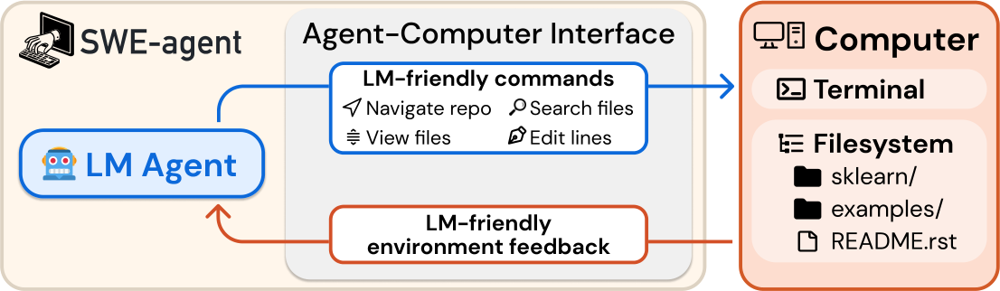
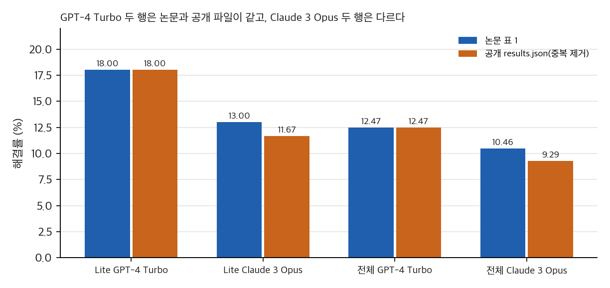
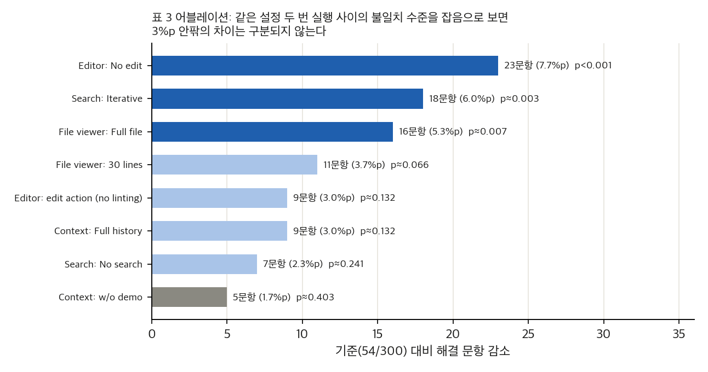
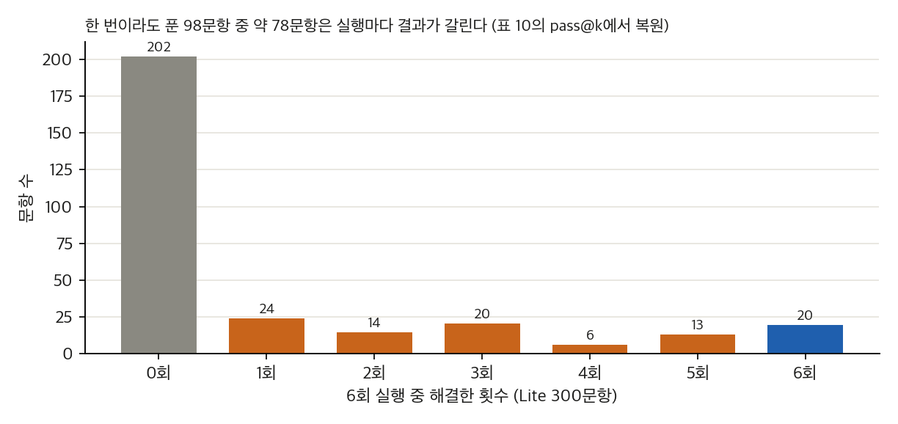
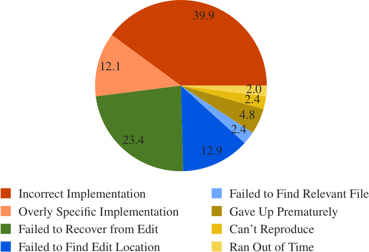

# SWE-agent의 인터페이스 설계는 어디까지 잡음 위에 있나

SWE-agent(Yang et al., NeurIPS 2024)는 "에이전트가 쓰는 인터페이스를 설계 대상으로 삼으면 모델을 바꾸지 않고도 성능이 크게 오른다"고 주장합니다. 공개 결과 파일(SWE-bench/experiments 저장소의 문항별 해결 목록, 0.7 MB)과 논문 표로 수치를 다시 계산하고, 공식 코드(v0.3.0)를 정적으로 읽어 논문과 맞춰 보았습니다. 코드 실행과 LLM 호출은 하지 않았습니다.

## 논문이 한 일

저자들은 에이전트와 컴퓨터 사이의 계층을 ACI라 부르고 네 원칙을 세웁니다. 행동은 단순하게, 간결하게, 피드백은 정보가 있되 짧게, 그리고 가드레일을 둡니다. 구현은 검색 명령 3개, 100줄 파일 뷰어, 줄 범위를 한 번에 바꾸는 `edit`(편집마다 문법 검사기가 돌고 오류면 편집을 버림), 최근 5개 관찰만 남기는 기록 관리입니다. GPT-4 Turbo로 SWE-bench 전체 2,294문항의 12.47%, Lite 300문항의 18.00%를 풉니다.

그림: 논문 그림 1. © 저자, CC BY 4.0, 출처 arXiv:2405.15793 (v3).

## 우리가 확인한 것

- **GPT-4 Turbo 수치는 정확히 재현됩니다.** 전체 286/2,294(95% 구간 11.2–13.9%), Lite 54/300(14.1–22.7%)이 공개 파일과 같습니다. RAG 기준선과는 구간이 겹치지 않습니다.
- **Claude 3 Opus 수치는 맞지 않습니다.** Lite는 표 1이 13.00%(39개)인데 표 6(저장소별), 표 7(연도별), 표 13(종료 방식)과 공개 파일은 모두 35개(11.67%)입니다. 전체 2,294문항은 공개 `results.json`이 해결 목록에 중복 28개를 포함하고, 중복 제거 213개(9.29%), 논문 표 13은 241개, 표 1은 10.46%(약 240개)로 어긋납니다. 궤적을 열어 봐야 확정됩니다.

- **"셸 대비 +10.7%p"는 조건이 다른 비교입니다.** 18.00은 데모를 넣은 SWE-agent이고 7.33은 데모 없는 셸 기준선입니다. 같은 조건끼리는 데모 있음 +7.0%p, 데모 없음 +9.0%p입니다. 방향은 최악의 불일치 가정에서도 유지됩니다(McNemar p ≤ 0.03).
- **어블레이션은 큰 차이만 잡음 위에 있습니다.** 표 3의 각 칸은 한 번의 실행이라 변형별 분산이 없습니다. 같은 설정을 두 번 돌릴 때의 불일치(표 10에서 추정, 약 36문항)를 잡음으로 보면, 편집 도구 제거(−7.7%p), 반복 검색(−6.0), 파일 전체 보기(−5.3)는 유의하지만 **linting 가드레일(−3.0%p)은 p ≈ 0.13**입니다. 주변 합만으로 가능한 McNemar p의 범위는 0.004–0.42입니다.

- **평균은 안정적이고 문항은 불안정합니다.** 6회 실행 평균 17.94%±0.49%p(모집단 SD)지만, pass@k(표 10)를 문항별 해결 횟수로 풀면 한 번이라도 푼 98문항 중 약 78문항이 실행마다 갈립니다. 게다가 관측된 변동(0.54%p)은 이 분포에서 독립 흔들림을 가정한 값(1.41%p)보다 작아 p = 0.018로 어긋납니다. 원인은 이 자료로 가릴 수 없습니다.

- **공식 코드와 상수가 다릅니다.** 논문은 검색 결과가 50개를 넘으면 거절한다고 쓰지만 코드는 100(파일 수·줄 수)입니다. 예산 $4는 코드 기본값 $3.0이 아니고, top-p 0.95는 논문에 없습니다. 형식 오류는 "올바를 때까지 반복"이 아니라 3회 초과 시 종료합니다. 표 3의 변형 8칸 중 두 칸(반복 검색, linting 없음)은 이 태그의 코드로 재구성되지 않습니다.
- **실패 유형 분석은 대략적인 값입니다.** 그림 8은 GPT-4o 자동 분류이고 사람 라벨 15개와의 일치 87%(13/15)는 구간이 62–96%입니다. 비율 계산의 n = 248은 표 1 기준 Lite 미해결 246개와 맞지 않습니다.

그림: 논문 그림 8. © 저자, CC BY 4.0, 출처 arXiv:2405.15793 (v3).

## 읽을 때 붙일 단서

- 2024년 초 모델(GPT-4 Turbo, Claude 3 Opus) 기준입니다. 같은 팀의 후속 mini-swe-agent는 bash 외 도구가 없고 "LM이 강해지면서 도구 대부분이 필요 없다"고 말합니다(저자 측 주장, 이 분석에서 재현하지 않음).
- 해결 = 숨은 테스트 통과입니다. 이후 연구는 SWE-bench에서 "해결"로 판정된 패치의 상당수가 약한 테스트 때문에 통과했음을 보였으므로(Verified 877개 패치에서 7.8%는 개발자 테스트 전체에서 실패), 12.47%와 18.00%는 정답 수정률이 아닙니다.
- 재현하지 않았습니다. 궤적(S3)과 평가 로그를 열면 Opus 전체 수치와 편집 회복률(90.5% → 57.2%)을 확인할 수 있습니다.

## 자료

- [통합 리포트 PDF](report/report_public.pdf)
- [01. 논문 분석: SWE-agent (arXiv:2405.15793v3)](analysis/01_paper_analysis.md)
- [02. 계보와 관련 연구: SWE-agent](analysis/02_prior_work.md)
- [03. 재계산과 통계 검정](analysis/03_analysis.md)
- [04. 논문과 공식 코드 대조 (정적 읽기)](analysis/04_code_verification.md)
