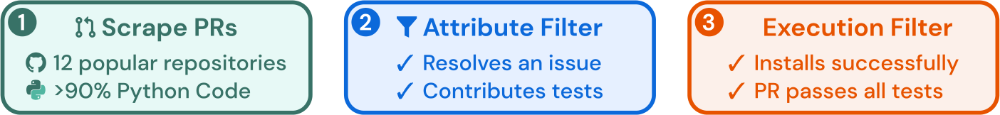
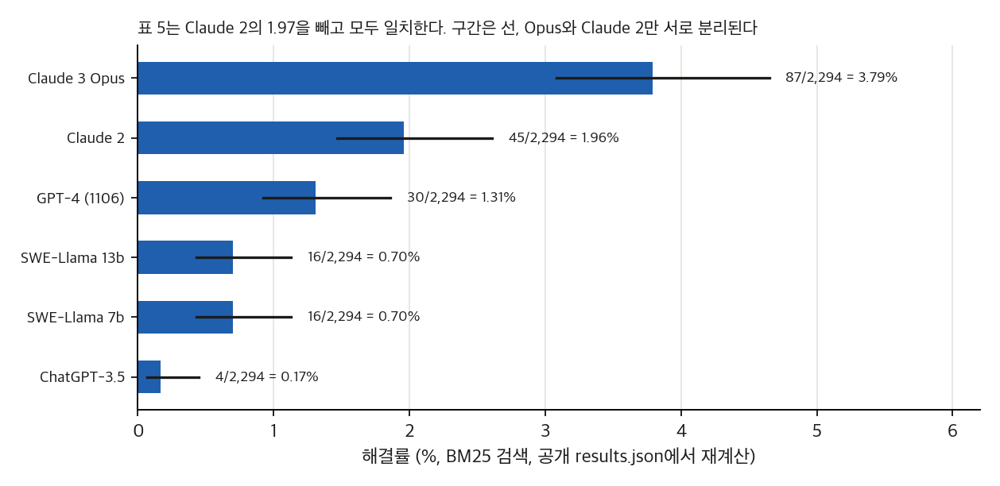
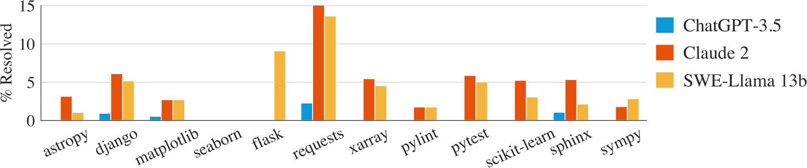
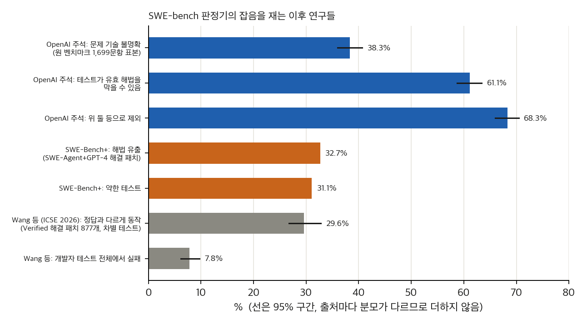
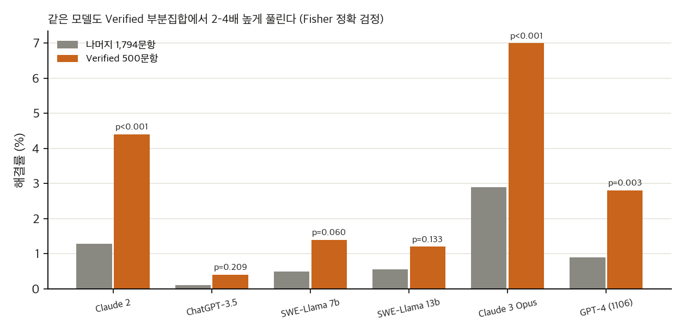

# SWE-bench의 숨은 테스트는 무엇을 재는가

SWE-bench(Jimenez et al., ICLR 2024)는 실제 GitHub 이슈와 그것을 닫은 병합 PR을 짝지어, 모델이 만든 패치를 저장소의 테스트로 채점하는 벤치마크입니다. 이후 코드 에이전트 평가의 대부분이 이 틀 위에 서 있습니다. 공개 데이터셋(HF), 공개 결과 파일(SWE-bench/experiments, 문항별 해결 목록), 공식 저장소의 두 시점 판본을 읽고 논문의 수치와 채점 방식을 확인했습니다. 코드 실행, Docker, LLM 호출은 하지 않았습니다.

## 논문이 한 일

93,139개 PR에서 "이슈를 닫고 테스트를 바꾼" 병합 PR을 고르고, PR 적용 전후로 테스트를 돌려 실패에서 통과로 바뀐 테스트(FAIL_TO_PASS)가 하나 이상 있는 2,294문항만 남깁니다. 모델은 이슈 글과 저장소를 받아 패치를 내고, 테스트 패치와 함께 적용한 뒤 FAIL_TO_PASS와 PASS_TO_PASS(정답 전후 모두 통과하던 테스트) 전부가 통과하면 "해결"입니다. 기준선은 BM25 검색 + 한 번 생성이고 Claude 2가 1.96%로 가장 높았습니다(초록).

그림: 논문 그림 2. © 저자, CC BY 4.0, 출처 arXiv:2310.06770 (v3).

## 표는 맞습니다, 순위는 약합니다

6개 제출의 문항별 해결 목록으로 표 5를 다시 세면 Claude 2의 1.97을 빼고 모두 일치합니다(1.97은 어떤 k/2,294에도 맞지 않고 1.96이 맞습니다). 문제는 크기입니다. 해결이 수십 개라 구간이 넓습니다.

- 전체 2,294문항에서 Claude 3 Opus(87개)와 Claude 2(45개)는 짝지은 McNemar로 구분되지만(p=1e-5), Claude 2와 GPT-4-turbo(30개)는 구분되지 않습니다(p=0.067).
- Lite 300문항에서는 15쌍 중 다중 비교 보정 뒤에도 구분되는 쌍이 하나뿐입니다. Lite의 순위는 인용하기 어렵습니다.
- 초록의 "최고 모델 Claude 2"는 v3 표 5(Opus 3.79%)와 어긋납니다.
- 표 5의 "% Apply"는 공개 결과 파일의 `applied`와 정의가 다릅니다. 2023년 네 모델에서 파일 값은 논문 표 14의 Applies에서 Fixed(패치 고치기를 거친 것)를 뺀 수와 정확히 같습니다.

데이터 통계도 대부분 맞습니다(문항 수, 저장소별 수, 이슈 길이, F2P 평균). 어긋나는 곳은 전체 테스트 수 평균(120.8 대 132.5), xarray의 PASS_TO_PASS(297.5 대 543.1), 표 21의 연도별 합계(2,140), Lite의 저장소 수(본문 11개, 공개 데이터 12개)입니다. 공식 저장소 v2.0.0(2024-06)에 번들된 데이터가 이미 현재 데이터와 2,291/2,294문항에서 같아서, 논문 이후 2024-06 이전에 데이터가 한 번 개정된 것으로 보입니다.

그림: 논문 그림 4 (oracle 검색). © 저자, CC BY 4.0, 출처 arXiv:2310.06770 (v3).

## 채점 코드는 판본마다 다릅니다

공식 저장소에는 논문 시점의 태그가 없어서(가장 오래된 태그가 2024-06의 v2.0.0), 논문 이틀 뒤 커밋(`b829995`), v2.0.0, 현재 main을 정적으로 읽었습니다.

1. **적용 순서가 반대입니다.** 논문 시점은 테스트 패치를 먼저 적용하고 모델 패치를 나중에 붙입니다. v2.0.0부터는 모델 패치를 먼저 적용하고, 테스트 패치가 가리키는 기존 파일을 기준 커밋으로 되돌린 뒤 테스트 패치를 적용합니다. 모델이 테스트 파일을 고친 경우의 결과가 판본마다 달라질 수 있습니다. 테스트 패치가 새 파일을 만드는 문항이 113개(4.9%)라 이 경로의 노출은 작지 않지만, 실제로 쓰인 사례는 확인하지 못했습니다.
2. **PASS_TO_PASS는 전체 스위트가 아닙니다.** 테스트 명령은 테스트 패치가 건드린 파일 안의 테스트만 돌립니다. 회귀 검사의 범위가 "그 파일들"입니다.
3. **빈 집합 규칙.** PASS_TO_PASS가 비면 점수 1이고(67문항, 2.9%), 논문 시점 코드는 SKIPPED로 끝난 FAIL_TO_PASS를 성공으로도 실패로도 세지 않아 전부 skip이면 해결로 판정될 수 있었습니다. 현재 main이 이 허점을 주석으로 인정하고 고쳤습니다.
4. **"적용됨"의 정의가 셋입니다.** 논문 시점의 패치 고치기, v2.0.0의 `git apply` 한 번, main의 4단계 적용. 논문의 % Apply와 이후 리더보드의 값은 비교할 수 없습니다.
5. 논문 부록의 여섯 분류(No-Op, Regression 등)는 공개 코드에 구현이 없습니다.

저장소 변경 기록은 2024-03-31 이전 판본을 쓰지 말라고 쓰고 있어, 논문 수치가 어느 판본으로 채점되었는지는 코드로 알 수 없습니다.

## 해결과 미해결은 얼마나 믿을 만한가

원 벤치마크에는 정답 라벨이 없고 "숨은 테스트 통과"가 해결입니다. 이후 연구가 이 판정기를 재었습니다.

OpenAI의 SWE-bench Verified 주석(2024-08)은 무작위 1,699문항 중 38.3%가 문제 기술 불명확, 61.1%가 테스트가 유효한 해법을 막을 수 있음으로 표시되었고 68.3%가 제외되어 500문항이 남았습니다. 반대쪽, 해결 판정의 정확성에 대해서는 SWE-Bench+가 SWE-Agent+GPT-4 해결 패치의 약 3분의 1이 해법 유출, 약 3분의 1이 약한 테스트라고 보고했고, Wang 등(ICSE 2026)은 Verified의 해결 패치 877개 중 7.8%가 개발자 테스트에서 정답과 다르게 실패하고 29.6%가 정답과 다르게 동작한다고 보고했습니다.

우리 데이터로 직접 보이는 것은 선택 효과입니다.

같은 모델의 공개 결과를 Verified 500문항 대 나머지 1,794문항으로 나누면 Claude 3 Opus 7.0% 대 2.9%(오즈비 2.5, Fisher p=9e-5)이고 6개 모델 모두 같은 방향입니다(오즈비 2.2–3.6, 해결이 적은 모델은 구분되지 않음). 필터가 불명확·부당 테스트를 걸러 해결하기 쉬운 문항을 남겼다는 해석과 맞지만, Verified 선택에는 난이도 주석도 쓰이므로 원인을 가릴 수는 없습니다.

## 정리

- 틀의 가치는 큽니다. 수작업 라벨 없이 실제 PR의 테스트를 채점기로 재활용한다는 설계가 규모를 만들었습니다.
- 그러나 해결 판정은 테스트의 충분성에 기대고, 회귀 검사의 범위는 좁고, 판정 불가(인프라 실패)는 "미해결"로 접히며, 채점 코드는 판본마다 다릅니다. SWE-bench 해결률을 인용할 때는 데이터 분할, 하네스 판본, 표본 크기를 함께 적는 편이 안전합니다.
- 한계: 공개 결과 파일은 BM25 설정뿐이라 oracle 설정의 문항별 검정은 하지 못했고(주변 합으로 가능한 범위만 계산), 공식 코드는 실행하지 않았습니다. 후속 연구의 수치는 각 논문의 공개 값을 정리한 것이며 재현하지 않았습니다.

## 자료

- [통합 리포트 PDF](report/report_public.pdf)
- [01. 논문 분석: SWE-bench (arXiv:2310.06770 v3)](analysis/01_paper_analysis.md)
- [02. 계보와 관련 연구](analysis/02_prior_work.md)
- [03. 재계산과 검정](analysis/03_analysis.md)
- [04. 논문 대 공식 코드 정적 대조](analysis/04_code_verification.md)
