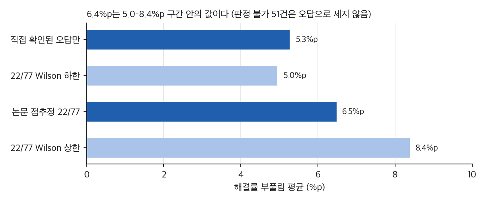
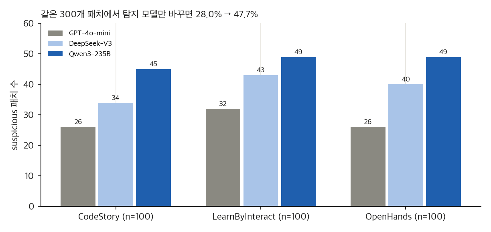
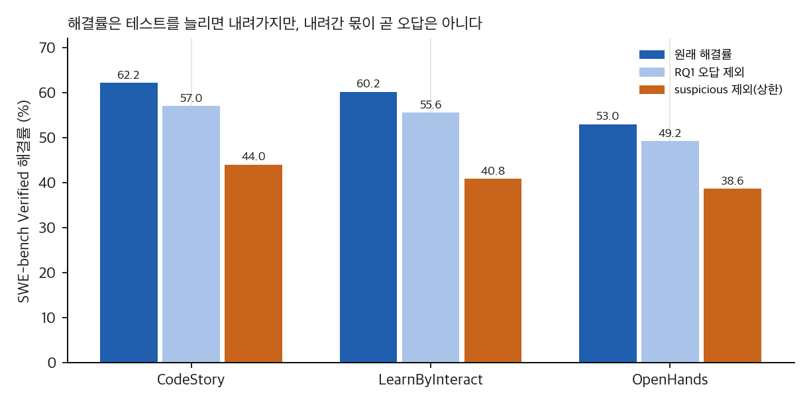

# SWE-bench에서 "해결"된 패치는 정말 해결된 걸까

SWE-bench Verified는 생성 패치를 **이슈를 고친 PR이 바꾼 테스트 파일만** 돌려 판정합니다. Wang, Pradel, Liu(ICSE 2026)는 테스트를 통과한 패치가 실제로 맞는지 세 도구(CodeStory, Learn-by-interact, OpenHands)의 해결 패치 877개로 확인했습니다. 공개 결과 파일(Zenodo)로 표를 다시 계산해 보았습니다. 패치 실행이나 LLM 호출은 하지 않았습니다.

## 논문이 한 일

1. **저장소의 모든 개발자 테스트를 돌립니다(RQ1).** 정답 패치에서는 통과하고 생성 패치에서는 실패하는 테스트가 있으면 회귀로 봅니다.
2. **PatchDiff로 차별 테스트를 만듭니다(RQ2).** gpt-4o-mini가 두 패치의 차이를 드러내는 테스트를 쓰고, 20번씩 돌려 흔들림을 걸러 냅니다. 차별 테스트가 하나라도 있으면 suspicious 패치입니다.
3. **suspicious 77건을 손으로 분류합니다(RQ3, RQ4).** 확실한 오답, 확실한 정답, 판정 불가로 나눕니다.

## 우리가 확인한 것

- **표는 모두 재현됩니다.** 해결 패치 877개 중 68개(7.8%, 95% 구간 6.2–9.7%)가 개발자 테스트 전체에서 실패하고, 260개(29.6%, 26.7–32.8%)가 suspicious입니다. 표 1, 2, 4, 7, 8이 파일 집계와 같습니다.
- **suspicious는 오답이 아닙니다.** 손으로 본 77건 중 확실한 오답 22건(28.6%), 확실한 정답 4건, **판정 불가 51건(66.2%)**입니다. 판정 불가는 이슈 문장이 구현 세부를 정하지 않은 경우입니다.
- **6.4%p 부풀림에는 구간이 필요합니다.** 계산은 재현되지만(6.48%p) 22/77의 Wilson 구간(19.7–39.5%)으로 외삽하면 5.0–8.4%p입니다. 외삽 없이 확인된 오답만 세면 5.3%p입니다. 판정 불가 51건은 세지 않은 하한 쪽 값입니다. arXiv 메타데이터와 v1 초록은 6.2%p, v2 본문은 6.4%p입니다.

- **29.6%는 탐지 모델에 묶인 값입니다.** 같은 300패치에서 GPT-4o-mini 28.0%, DeepSeek-V3 39.0%, Qwen3-235B 47.7%(짝지은 McNemar p < 0.001). 논문의 29.6%는 가장 약한 모델의 값입니다.

- **도구 간 차이는 표본 오차 안입니다.** suspicious 비율 29.3, 32.2, 27.2%는 χ² p = 0.41입니다. LearnByInteract 대 OpenHands 해결률 차이(60.2 대 53.0)는 원래 유의하지만(같은 500문항 짝지은 McNemar p = 0.003) suspicious를 빼면 유의하지 않습니다(p = 0.37). 다만 이는 "다르게 동작함"으로 거른 것이라 순위가 뒤집혔다는 증거는 아닙니다.

- **"추가 변경이 오답의 징후"는 표본에서 유의하지 않습니다.** 추가 변경 유형 8/21이 오답, 나머지 14/56이 오답(Fisher p = 0.27).
- **생성 패치가 정답보다 훨씬 클수록 suspicious가 많습니다.** 소스 변경 줄이 정답의 2배를 넘는 패치의 44.1%, 아닌 패치의 25.9%가 suspicious입니다(p < 0.0001). 정답이 큰 문항이 겹치는 교란이 있어 방향만 참고합니다.
- **검사하지 못한 패치가 있습니다.** 정답과 같지 않은 패치 850개 중 127개(14.9%)는 대상 함수를 찾지 못해 차별 테스트 생성을 하지 못했습니다. 의심 없음이 아니라 검사하지 못함입니다.

## 공식 코드와 대조

PatchDiff 저장소(라이선스 없음)를 정적으로 읽었습니다. 방법의 뼈대(대상 함수 선정, 20회 흔들림 필터, 온도 1, n=10)는 논문과 일치합니다. 차이는 세 가지입니다. RQ1의 "코딩 규칙 제외"는 코드가 아니라 결과 파일에 기록된 수작업 분류이고(LearnByInteract는 불일치 51건 중 28건 제외), 차별 테스트 필터는 서술보다 느슨하며, 생성 패치 실행이 타임아웃이면 20회 검증을 건너뜁니다(영향 인스턴스 1개). 표 3(비용)과 표 4(다른 LLM)는 코드만으로 재현할 수 없고 결과 파일만 공개되어 있습니다.

## 인용할 때

- 인용해도 되는 것: 7.8%(표 1), 29.6%(표 2), 수작업 77건의 분류(표 7, 8).
- 붙일 단서: 평가한 세 도구는 2024년 말–2025년 초 제출이고, 22/77은 하한이며, 판정자는 한 명이고, 29.6%는 GPT-4o-mini 기준입니다.

## 이후 연구

UTBoost(ACL 2025)와 SWE-ABS(arXiv:2603.00520, 상위 30개 에이전트 재평가에서 이전 통과 패치의 19.71% 거부), Probe to Generate(arXiv:2604.01518, 상위 10개 에이전트 해결률 4.2–9.0% 하락)가 테스트 강화 방향으로 같은 결론을 확인합니다. 2026년 2월 OpenAI는 Verified 점수 보고를 중단했습니다(일관되게 못 푼 138문항 중 59.4%에 테스트 또는 명세 결함). 수치는 대상과 방법이 달라 직접 비교하지 않습니다.

## 자료

- [통합 리포트 PDF](report/report_public.pdf)
- [01. 논문 분석: Are "Solved Issues" in SWE-bench Really Solved Correctly?](analysis/01_paper_analysis.md)
- [02. 계보와 관계: Are "Solved Issues" in SWE-bench Really Solved Correctly?](analysis/02_prior_work.md)
- [03. 재계산과 검정: Are "Solved Issues" in SWE-bench Really Solved Correctly?](analysis/03_analysis.md)
- [04. 코드 대조: 논문 ↔ 공식 저장소(PatchDiff)](analysis/04_code_verification.md)
