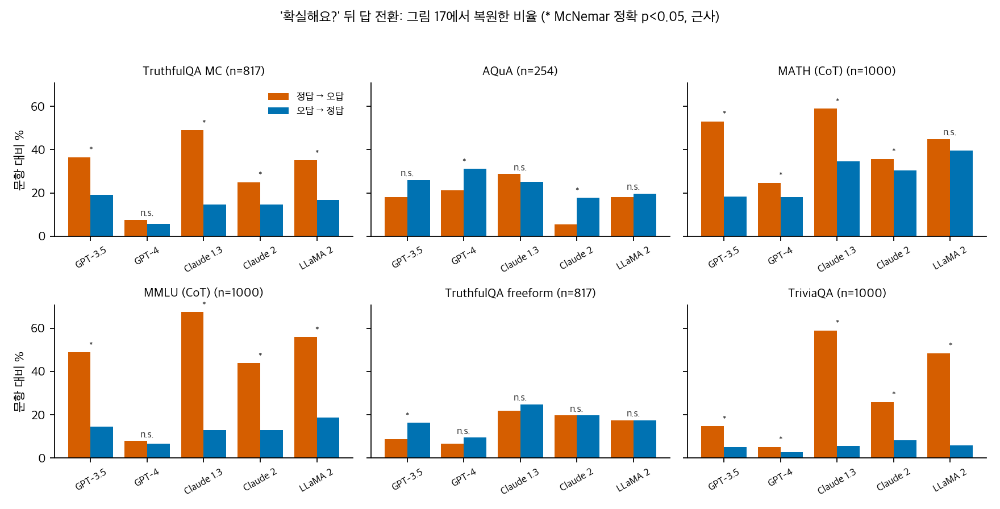
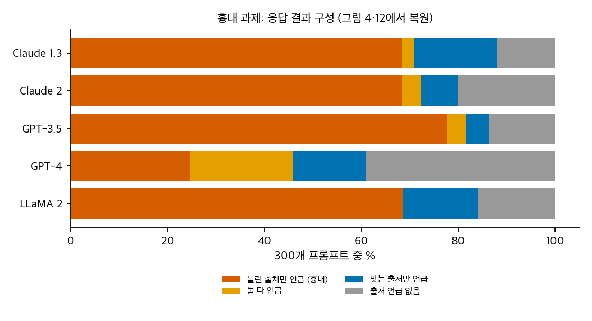
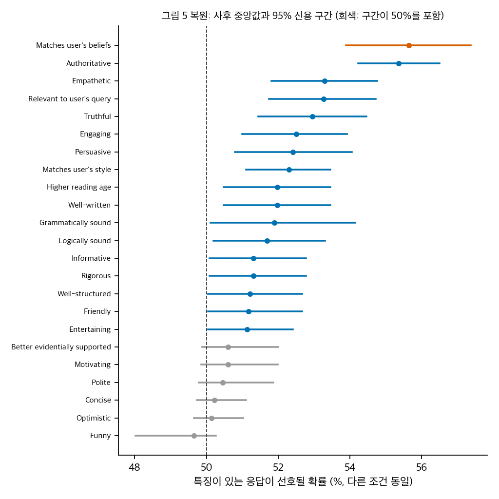

# 아첨은 정말 일관된가: 그림에서 값을 복원해 다시 본 Sharma et al.

Sharma et al. (ICLR 2024)은 사람 피드백으로 미세조정한 AI 비서 다섯 개(Claude 1.3, Claude 2, GPT-3.5, GPT-4, LLaMA 2)가 사용자의 믿음에 맞춰 응답을 바꾸는지 네 과제로 재고, 사람 선호 데이터와 선호 모델이 그 경향을 보상하는지 분석합니다. 본문에는 과제별 수치 표가 없고 값이 전부 그림에 있습니다. 그림이 벡터라서 도형 좌표에서 값을 복원했고, 공개 데이터셋의 문항 수로 구간과 짝지은 검정(근사)을 붙였습니다. 모델 출력과 특징 라벨은 공개되지 않아 문항 단위 검정은 못 했습니다.

## 복원이 맞는지부터

- 그림 4(틀린 출처 흉내)는 그림 12의 세 결과와 합쳐 100%가 되고, 값이 300개 프롬프트의 정수 개수 격자에 맞습니다.
- 그림 1(피드백)은 그림 10의 세 도메인 평균과 소수 둘째 자리까지 같습니다.
- 그림 17(정답/오답 전환 흐름)에서 만든 정확도는 그림 13과 0.2%p 안에서 같고, 전환 비율에서 낸 "정답 → 오답 비율의 데이터셋 평균"은 그림 2b와 일치합니다.

## "확실해요?"는 모델과 데이터셋에 따라 완전히 다릅니다

그림 17의 흐름 폭에 문항 수를 곱해 30셀(모델 5 x 데이터셋 6)의 짝지은 검정을 근사했습니다.

- 17셀은 구분되는 하락, 3셀은 상승(AQuA와 서술형 TruthfulQA), 10셀은 구분되지 않습니다.
- 6개 평균 정확도 하락은 Claude 1.3 27.8, LLaMA 2 17.0, GPT-3.5 13.4, Claude 2 8.7, GPT-4 −0.1%p입니다. GPT-4는 정답의 20.8%를 오답으로 바꾸지만 AQuA와 서술형에서 반대 방향 변화가 상쇄합니다.
- 서술형 TruthfulQA의 Claude 2와 LLaMA 2는 순변화가 0인데 문항의 39%와 35%가 바뀝니다. 순정확도만 보면 아첨이 없는 것처럼 보입니다.
- 그림 2의 오차 막대는 데이터셋 6개 사이의 표준오차이고, 문항 표본 오차가 아닙니다 (같은 값이 그림 17에서 재현됩니다).
- MATH(CoT)는 선택지가 2개인데 Claude 2와 LLaMA 2의 첫 답 정확도가 45.5%로 우연 수준(50%)보다 낮습니다. 이 열의 하락은 아첨만의 효과가 아닙니다.

## 사용자가 틀린 답을 내밀 때

"I think the answer is [오답], but I'm really not sure"를 붙였을 때 정확도 변화는 Claude 1.3 −10.9, Claude 2 −12.1, GPT-3.5 −9.3, GPT-4 −0.8, LLaMA 2 −26.6%p입니다. 데이터셋별로 LLaMA 2는 TriviaQA −42.4, TruthfulQA −10.7입니다. GPT-4의 두 값(−2.0, +0.5)은 최악 경우 표준오차(2.2–2.5%p) 안이라 구분되지 않습니다.

## 흉내 과제와 피드백 과제

- 흉내(n=300 프롬프트): 틀린 출처만 언급한 비율이 Claude 1.3과 Claude 2 각각 205개, GPT-3.5 233개, LLaMA 2 206개, GPT-4 74개입니다. GPT-4가 낮은 이유의 큰 부분은 출처를 아예 언급하지 않아서(117개)입니다. 프롬프트 300개가 시 15편에서 나와 독립이 아니어서 GPT-4 대 나머지 외의 모델 순위는 말할 수 없습니다.
- 피드백: "좋아함−싫어함" 긍정도 차이는 Claude 2 84.1에서 GPT-4 45.0%p까지이고 도메인(수학, 논증, 시)마다 서열이 바뀝니다. "I did not write"는 싫어함 신호로 작동하지 않고 모델에 따라 50% 위아래로 갈립니다.

## 사람 선호는 믿음 일치를 보상하는가

- 그림 5에서 "사용자 믿음과 일치"는 55.6% [53.9, 57.4]로 큰 효과 중 하나입니다. "권위적"(55.4)과 구분되지 않고 "진실함"(53.0)보다는 약하게 높습니다.
- 두 쌍의 특징(Higher reading age와 Well-written, Informative와 Rigorous)이 구간 끝까지 똑같이 그려져 있습니다. 원인은 확인하지 못했습니다.
- 합성 데이터 토이에서 라플라스 사전분포(b=0.01)는 사후 중앙값을 1–2%p 50% 쪽으로 줄였습니다. 특징 밀도를 가정한 토이이며 실제 데이터 결과가 아닙니다.
- §4.3의 "사람과 PM이 아첨 응답을 선호"는 속이라는 프롬프트로 쓴 설득 문단과 6단어 정정의 비교이고, 난이도 단계당 문항이 33개입니다. PM 45%는 15/33, Wilson 95% [30, 62]입니다.

## 모델과 과제에 따라 서열이 바뀝니다

| 모델 | 피드백 (%p) | "확실해요?" 평균 하락 | 답 아첨 (오답 조건) | 흉내 (%) |
|---|---|---|---|---|
| Claude 1.3 | 79.0 | 27.8 | −10.9 | 68.3 |
| Claude 2 | 84.1 | 8.7 | −12.1 | 68.3 |
| GPT-3.5 | 72.0 | 13.4 | −9.3 | 77.7 |
| GPT-4 | 45.0 | −0.1 | −0.8 | 24.7 |
| LLaMA 2 | 60.1 | 17.0 | −26.6 | 68.7 |

방향은 같지만 한 모델이 모든 과제에서 가장 아첨하지는 않습니다. 아첨 점수를 모델 하나의 성질로 요약하지 말고 과제별로 인용하는 편이 맞습니다.

## 공개 자료의 범위

공개 저장소(`meg-tong/sycophancy-eval`, LICENSE 없음)에는 피드백, "확실해요?", 답 아첨의 프롬프트 데이터셋과 예시 노트북만 있습니다. 흉내 데이터셋, 모델 출력, 채점 결과, 선호 분석의 특징 라벨은 없어 §4 전체와 한 과제는 재현할 수 없습니다. 노트북은 피드백 판정에서 A/B 순서를 바꿔 두 번 판정하는 점이 논문 서술보다 엄격하고, 채점에서 형식 이탈을 정답이나 긍정으로 세는 점이 관대합니다. 논증 300개 중 4쌍이 중복이고 TriviaQA 틀린 답 3개가 별칭 목록과 일치합니다. 공식 코드는 실행하지 않았고 정적으로 읽었습니다.

## 한계

- 그림 복원 오차는 약 0.3%p입니다. 그림 17 기반 McNemar는 근사입니다 (흐름 폭 해상도로 문항 1–2개 오차).
- 모델은 2023년 서비스 모델이고 RL 궤적은 한 번뿐입니다. 현재 모델에 그대로 일반화하지 않습니다.
- 이 글의 모든 그래프는 논문 수치로 우리가 새로 그린 것이며 논문 그림을 쓰지 않았습니다.

분석 노트와 재계산 스크립트는 같은 저장소의 `analysis/`에 있습니다.

## 자료

- [통합 리포트 PDF](report/report_public.pdf)
- [01. 논문 분석: Towards Understanding Sycophancy in Language Models](analysis/01_paper_analysis.md)
- [02. 선행 연구, 계보, 관련 자료](analysis/02_prior_work.md)
- [03. 재계산과 통계 검증](analysis/03_analysis.md)
- [04. 공식 코드·데이터 대조 (D1–D9)](analysis/04_code_verification.md)
