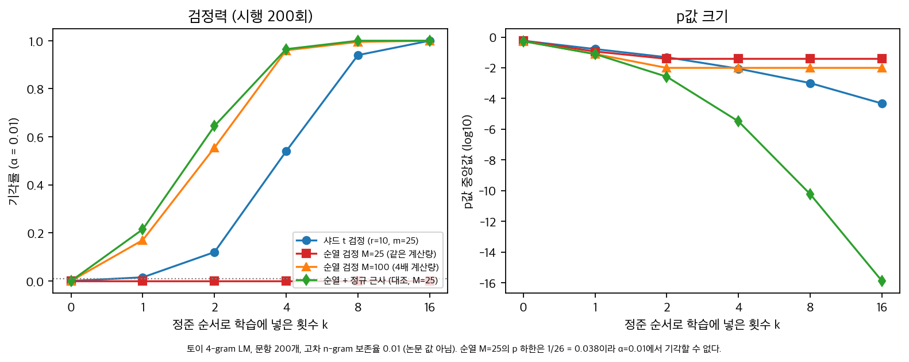
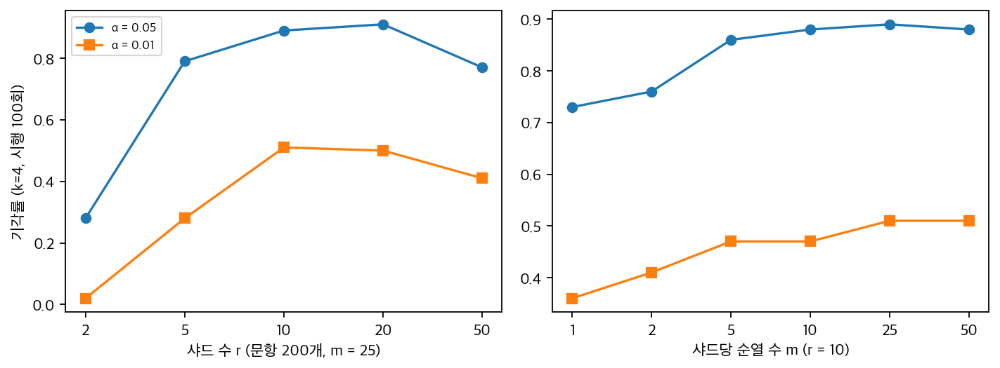

# 벤치마크가 학습에 들어갔다는 것을 어떻게 증명하나

LLM이 벤치마크 문항을 학습 중에 봤는지 알고 싶은데, 학습 데이터도 가중치도 없다면 무엇을 할 수 있을까요? Oren, Meister, Chatterji, Ladhak, Hashimoto의 *Proving Test Set Contamination in Black Box Language Models* (ICLR 2024)는 **문항의 순서**를 단서로 씁니다. 벤치마크는 문항 집합이라 순서에 의미가 없습니다. 모델이 공개 저장소의 순서(정준 순서)를 다른 순서보다 더 그럴듯하게 여긴다면, 그것은 그 순서로 학습 중에 봤다는 증거입니다. 이 글은 이 검정을 numpy로 직접 짜고(`minimal_impl.py`, 테스트 `test_minimal_impl.py`), 식을 유도해 검산하고, 작은 n-gram 언어 모델로 1종 오류율과 검정력을 잰 기록입니다. 공식 코드는 정적으로 읽기만 했고 실행하지 않았습니다.

## 검정이 하는 일

1. 문항을 이어 붙인 정준 순서의 로그우도 ℓ(정준)을 구합니다.
2. 같은 문항을 무작위로 섞은 순열의 로그우도 ℓ(순열)을 여러 번 구합니다.
3. **순열 검정**: 정준보다 로그우도가 높은 순열의 비율을 p로 씁니다. 오염이 없으면 정준 순서도 "여러 순서 중 하나"일 뿐이라 이 p는 균등입니다.
4. **분할 검정**: 문항을 r개 샤드로 나눠 샤드 안에서만 섞고, 샤드마다 s_i = ℓ(정준) − 평균 ℓ(순열)을 구한 뒤 s_i의 평균에 단측 t 검정을 합니다.

## 왜 정확한가

정준 순서가 문항에 대해 균등한 무작위 순서이고 순열이 독립이면, (정준, 순열 1, ..., 순열 m)의 로그우도는 교환 가능한 m+1개 값입니다. 그래서 정준보다 높거나 같은 순열 수 R의 분포는 R ≤ ρ일 확률이 (ρ+1)/(m+1) 이하이고, p̂ = (1 + R)/(m+1)이면 **모든 α에서 P(p̂ ≤ α) ≤ α**입니다. 점근이 아니라 유한한 m에서의 보장입니다. 두 가지를 확인했습니다.

- 논문 식은 정준보다 **엄격히** 높은 순열만 세는데, 동점이 있으면 p가 작아지는 방향이라 유효성이 깨질 수 있습니다. 구현은 "높거나 같은"을 셉니다.
- 이 보장에는 "공개된 순서가 무작위 순서"라는 가정이 들어 있습니다. 문항이 난이도·주제순으로 정렬돼 배포됐다면 오염이 없어도 p가 치우칩니다.

## 분할 검정의 이점은 샤딩이 아니다

샤드 검정의 계산량은 문항 평가 n(1+m)번이고 전체 순열 M번과 M = m에서 **같습니다**. 귀무 아래 신호 대 잡음비도 같습니다(샤드 합의 이득 rδ, 순열 표준편차 √r·τ). 순열 검정은 p ≥ 1/(m+1)이라 m = 25면 0.038 아래로 못 내려가는데, 분할 검정은 t 분포의 꼬리를 써서 그 아래를 만듭니다. 그러니 이점은 **작은 α에서 기각이 가능하다는 것**, 곧 정규 꼬리 외삽입니다.

## 토이 언어 모델로 시험

문항 200개(토큰 6–12개), 배경 10만 토큰에 벤치마크를 정준 순서로 k번 끼워 넣고 4-gram(Witten-Bell) 모델을 매번 새로 학습했습니다. 문맥이 SEP를 넘어 앞 문항의 끝 토큰까지 닿아야 순서를 기억할 수 있어 order = 4를 썼고, "여러 번 봐야 외운다"를 흉내 내려 고차 n-gram 출현을 확률 0.01로만 셉니다(토이 가정, 논문 값이 아님). numpy n-gram을 고른 이유는 수백 번 반복해 1종 오류율을 재야 하기 때문입니다. transformer는 시행마다 학습에 수 분이 듭니다.

- **오염 없음(k = 0), 1,000번 시행**: 샤드 t의 기각률은 α = 0.05에서 0.027, α = 0.01에서 0.003으로 보수적이었고 순열 검정은 이론 상한 안(M = 25는 0.030, M = 100은 0.043)이었습니다. 1종 오류율은 α를 넘지 않았습니다.
- **오염 횟수와 검정력**: 샤드 t(α = 0.05)의 기각률은 k = 0, 1, 2, 4, 8에서 0.03, 0.17, 0.52, 0.87, 1.0. 1회는 거의 못 잡고 2–4회에서 문턱을 넘습니다. 논문 그림 2의 "문턱 약 4회"와 같은 모양이지만 보존율 선택의 결과라 대응을 주장할 수 없습니다.
- **같은 계산량에서 누가 강한가**: α = 0.05에서는 순열 M = 25가 오히려 더 강했습니다(k = 2에서 0.715 대 0.515). α = 0.01에서는 순열 M = 25가 **기각 자체가 불가능**하고 샤드 t만 기각합니다(k = 4에서 0.54). 순열 분포에 정규를 맞추는 대조 검정은 모든 k에서 샤드 t보다 강했습니다. 샤드 t는 H1 아래에서 s_i의 표본 표준편차로 나누는데, 토이에서 이것이 귀무 순열 표준편차의 약 2배로 부풀어 통계량이 절반이 됩니다.
- **정준 순서가 학습에 없으면 검출되지 않는다**: 복사본마다 순서를 새로 섞어 16번 넣었더니(문항은 16번 외움) 기각률이 α = 0.05에서 0.027이었습니다. 이 검정이 보는 것은 문항의 포함이 아니라 **순서의 암기**입니다. 순서를 섞어 학습하거나 섞어 배포된 벤치마크의 오염은 이 검정이 놓칩니다.

샤드는 샤드당 10–20문항에서 가장 좋았고, 너무 크거나(r = 2, df = 1) 너무 작으면(샤드당 4문항) 떨어졌습니다. 순열 수는 5–10회부터 평탄합니다.

## 논문 표 다시 계산하기

- **표 4로 표 2의 MMLU 행 재현.** 부록 D 표 4의 파일별 p에서, 음성 대조(GPT-2 XL, BioMedLM)가 p ≤ 0.05인 파일을 제외하고(13개 + 표 4에 없는 professional_law = 14개, 43개 남음) Fisher로 합치면 LLaMA2 0.0146, Mistral 0.0113, Pythia 0.362로, 논문의 0.014, 0.011, 0.362와 맞습니다.
- **음성 대조가 명목 5%를 훌쩍 넘는다.** 같은 표에서 GPT-2 XL은 56개 파일 중 10개, BioMedLM은 9개가 p < 0.05(기대 약 2.8개). 파일의 정렬 구조 때문에 교환성이 깨진 것으로 보이고, 논문이 14개를 제외한 이유입니다.
- **표 2의 p는 균등하지 않다.** 5모델 × 7데이터셋 35개 중 0.9 초과가 12개(기대 3.5)이고 KS 검정이 균등을 기각합니다(p = 0.014). 한쪽으로 치우쳐 "증거 없음"의 무게가 보이는 것보다 약합니다. Mistral-Arc의 0.001은 검정 수 28–35에서는 Bonferroni를 통과하지만 65개 파일 기준이면 0.065로 통과하지 못합니다.

## 공식 코드와 다른 점

분할 검정만 구현돼 있고(순열 검정 코드 없음) 샤드 나누기는 우리 구현과 같습니다. 통계량은 `np.std` 기본값(ddof = 0)을 써서 표준 t보다 √(r/(r−1))배 커지는데 r = 50에서 명목 5%가 실제 약 5.2%입니다. p를 `1 - cdf`로 계산해 ~1e-16 아래는 0이 됩니다. GPU(CUDA) 없이는 돌지 않습니다.

## 한계

- 로그우도 질의가 필요합니다. "블랙박스"라도 임의 텍스트의 프롬프트 토큰 로그우도를 주는 API여야 합니다.
- 중복이 적으면(논문 표 1에서 1회) 못 잡고, 축자 오염만 봅니다. 출처 데이터를 통한 간접 오염은 못 봅니다.
- 토이는 n-gram이라 transformer의 암기와 성격이 다릅니다. 토이의 보존율은 문턱을 중복 2–4회에 오게 정한 값입니다.
- 이후 문헌: 미세조정으로 만든 오라클(LLaMA-2-70B-chat)에서 정준 순서 검정은 대부분 반응하지 않았지만(Samuel et al., 검정을 100문항 10샤드로 줄이고 문항 4개씩 묶어 학습한 설정이라 직접 비교는 아님), 멤버십 추론은 분포 이동에 속는다는 비판(Duan et al., Das et al.)은 순열로 귀무를 만드는 이 검정에는 직접 적용되지 않습니다(우리 해석).

## 실무 메모

벤치마크를 새로 만들어 공개한다면 **문항 순서를 무작위로 섞어 배포하고 그 사실을 공지**하는 것이 이 검정이 나중에 쓰일 조건을 만드는 가장 싼 방법입니다(논문 §6의 권고). 이미 정렬된 파일을 검정한다면 음성 대조 모델로 먼저 비교환성을 점검해야 합니다.

## 자료

- [최소 구현](analysis/minimal_impl.py)
- [01. 논문 분석: Proving Test Set Contamination in Black Box Language Models (arXiv:2310.17623)](analysis/01_paper_analysis.md)
- [02. 선행 연구, 계보, 이후 문헌, 관련 분석](analysis/02_prior_work.md)
- [03. 분석: 식 유도 검산, 표 산술, 최소 구현과 토이 실험](analysis/03_analysis.md)
- [04. 주장 검증과 공식 코드 대조](analysis/04_claim_verification.md)
