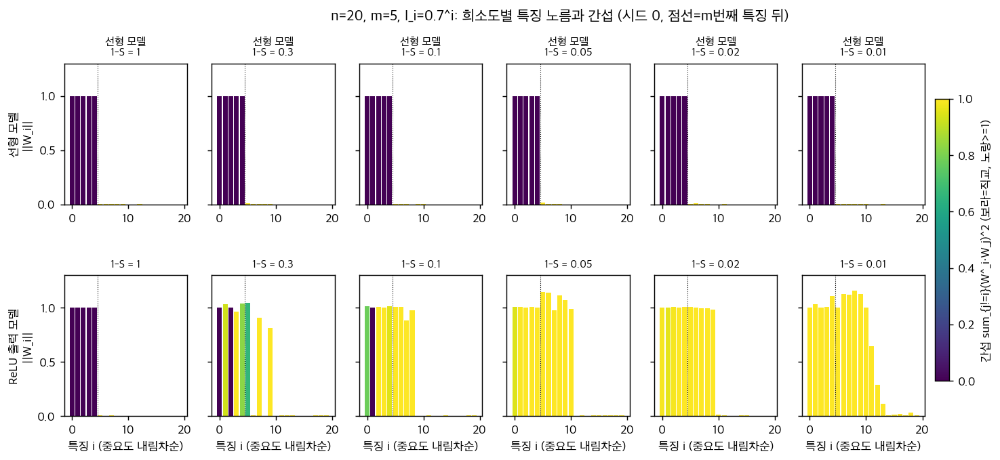
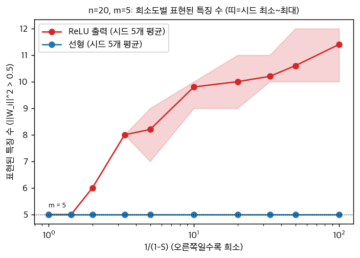
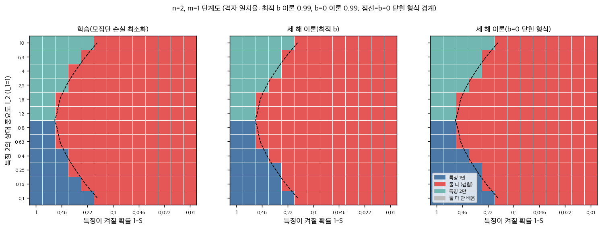
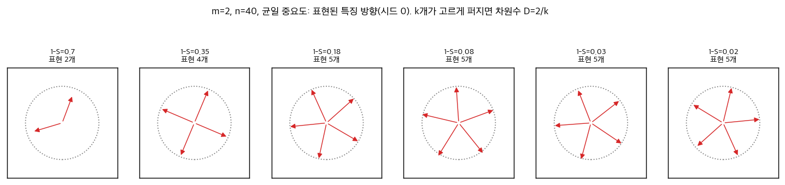
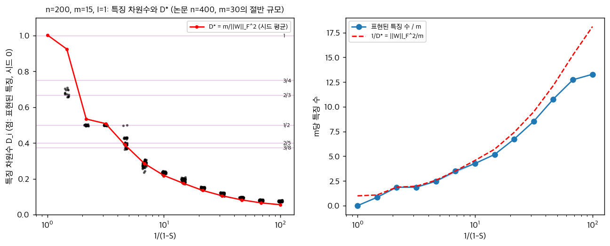

# 특징이 차원보다 많을 때 모델은 어떻게 하나

신경망의 한 뉴런이 서로 무관한 입력에 반응하는 다의 뉴런은 왜 생길까요? Elhage 등의 *Toy Models of Superposition*(Transformer Circuits, 2022)은 "특징이 뉴런 수보다 많고 드물게만 켜지면, 모델은 특징을 거의 직교인 방향에 **겹쳐 담는다**(superposition)"는 가설을 아주 작은 모델에서 만들어 보입니다. 이 글은 그 모델을 PyTorch로 직접 짜서(`minimal_impl.py`, CPU, 테스트 21개) 식을 유도해 검산하고 결과를 확인한 기록입니다. 논문 그림은 쓰지 않았고 아래 그래프는 모두 직접 그렸습니다. 공식 노트북은 읽기만 했고 실행하지 않았습니다.

## 모델

특징 n개 x는 각각 확률 S로 0, 아니면 U[0,1]입니다. 모델은 h = Wx (W는 m×n, m < n), x' = ReLU(WᵀWx + b)로 복원하고 손실은 Σ I_i (x_i − x'_i)²입니다. 특징 i의 방향은 W의 i번째 열이고, 노름 ‖W_i‖²가 1에 가까우면 그 특징을 담았다는 뜻입니다. ReLU를 뺀 선형 모델이 대조군입니다.

## 선형 모델은 상위 m개만, 희소도와 무관하게

편향을 최적화하면 잔차는 (I−M)(x−μ𝟙), M = WᵀW이고 입력 공분산이 σ²I라서 L = σ² tr(D(I−M)²) (D는 중요도 대각행렬)입니다. M을 고유분해하면 (I−M)² = I − Σ_k (2λ_k − λ_k²) u_k u_kᵀ이고 2λ−λ² ≤ 1이므로, Ky Fan 부등식으로 L ≥ σ²(중요도 하위 n−m개의 합)이고 등호는 M이 상위 m개 좌표의 투영일 때입니다. 희소도 S는 σ²라는 곱셈 인자로만 들어가 **어떤 특징을 고르는가는 S와 무관**합니다. n=20, m=5, I_i = 0.7^i에서 시드 5개로 학습해 보면 학습 손실이 이 이론값과 0.33% 이내(10개 희소도 전부)였고 담은 특징은 늘 5개였습니다.

## ReLU를 달면: 희소해질수록 더 담는다

같은 설정에서 ReLU 출력 모델은 밀집(1−S=1)이면 선형 모델과 손실이 5자리까지 같고 5개만 담습니다. 밀도가 내려가면 6개, 8개로 늘어 밀도 0.01에서는 평균 11.4개(시드 5개, 10–12개)를 담고, 이때 손실은 선형 모델의 0.18배입니다.

왜일까요? 입력 하나만 켜진 경우의 손실은 b=0이면 (1/3)[I_i(1−‖W_i‖²)² + Σ_{j≠i} I_j ReLU(W_i·W_j)²]입니다. 음의 내적은 ReLU에 걸려 **공짜**라서 대척점 쌍(내적 −1)은 이 항이 0입니다. 간섭 비용은 두 특징이 **함께** 켜질 때 생기므로 밀도 d에서 d²로 줄고, 특징을 더 담는 이득은 d로 줄어 희소할수록 이득이 이깁니다. 음의 편향은 작은 양의 간섭도 걸러 줍니다(c ≤ −b이면 적분 0).

## 2특징·1차원 단계도: 이론과 학습이 98.7% 일치

특징 2개를 1차원에 넣을 때 해는 세 가지로 근사됩니다: 특징 1만([1,0]), 특징 2만([0,1]), 둘 다 대척점([1,−1]). 중요도 (1, r), 밀도 d에서 손실은 L_A = rσ², L_B = σ², L_C = d²(1+r)/6 (σ² = d/3 − d²/4, E[min(x₁,x₂)²] = 1/6 사용)이고 b=0 근사의 경계는 r ≤ 1이면 d < 4r/(2+5r), r ≥ 1이면 d < 4/(5+2r)입니다. 곡선들이 서로 다른 기울기로 교차하므로 1차 전이입니다. 모집단 손실을 직접 최소화해 얻은 해의 분류는 12×13 격자 156칸 중 154칸(98.7%)에서 편향까지 최적화한 세 해 이론과 같았고, 겹침 118칸은 전부 w₁w₂ < 0(대척점)이었습니다. 다만 27칸에서는 학습 손실이 세 해의 최소보다 더 낮았습니다(가중치 크기가 [−1.04, 0.79]처럼 약간 비대칭). 세 해는 근사입니다.

## 특징 차원수: 1/2 계단은 선명, 나머지는 반쯤

특징 i의 "차원수"는 D_i = ‖W_i‖²/Σ_j(Ŵ_i·W_j)² 입니다. 직교면 1, 대척점 쌍이면 1/2, 정삼각형이면 2/3, 평면의 정k각형이면 2/k이고, 단위 벡터가 타이트 프레임이면 D_i = m/k이며 ΣD_i = m입니다.

m=2, n=40에서 밀도를 낮추면 2개 → 4개(두 대척점 쌍) → 5개(정오각형, D=2/5)로 바뀝니다(시드 3개 모두 같은 개수).

n=200, m=15(논문의 절반 규모)에서 밀도 0.46–0.32 구간은 표현된 28개 특징이 모두 D=1/2(14개의 대척점 쌍)였고, 0.68에서 삼각형(2/3)이, 0.22에서 2/5와 3/8 부근 값이 보였습니다. 밀도 0.15 아래에서는 특징 수가 n에 막혀 분수 계단이 흐려집니다. 논문이 보이는 3/4와 3/8 등 세밀한 계단 전체는 이 규모에서 재현하지 못했습니다.

## 이후 문헌이 바꾼 것

이 글의 "사후에 과완비 기저를 찾는다" 전략이 희소 오토인코더(SAE)로 실행되었지만(Cunningham et al. 2023, Anthropic의 Towards Monosemanticity와 Scaling Monosemanticity), 시드마다 특징이 달라지고(30%만 공유), 정답을 아는 합성 설정에서 참 특징의 9%만 복원했다는 보고(Korznikov et al. 2026)가 있어 "모델이 쓰는 참 특징을 열거한다"는 기대는 약해졌습니다. "특징은 1차원 방향"이라는 가정도 원형 다차원 특징(Engels et al. 2024)이 발견되어 수정되었고, 다의성이 superposition만의 결과가 아니라는 보고(Lecomte et al. 2023)도 있습니다. 반대로 superposition 상태에서의 계산(Hänni et al. 2024)과 규모에 따른 손실의 반비례 법칙(Liu et al. 2025)은 장난감 모델을 이론적으로 확장했습니다. 이들은 초록 기준으로 읽었고 재현하지 않았습니다.

## 한계

- 장난감 모델에서 일어난 일이 실제 LLM에서 일어난다는 증거는 이 글에도 없고 논문에도 정성적 일치뿐입니다.
- "희소하면 superposition"은 n=2, m=1에서만 닫힌 형식으로 확인했고 일반 n, m은 학습 관측입니다.
- 단계도의 "학습"은 표본이 아니라 모집단 손실의 결정적 최소화입니다. 표본 학습은 n=20과 n=200 실험입니다.
- 학습 동역학의 점프, 상관 특징, 적대적 취약성, 계산(abs)은 확인하지 않았습니다.

## 자료

- [최소 구현](analysis/minimal_impl.py)
- [01. 논문 분석: Toy Models of Superposition](analysis/01_paper_analysis.md)
- [02. 계보, 가까운 대안, 이후 문헌, 관련 분석](analysis/02_prior_work.md)
- [03. 식 유도 검산과 최소 구현 결과](analysis/03_analysis.md)
- [04. 주장 검증과 공식 노트북 대조](analysis/04_claim_verification.md)
