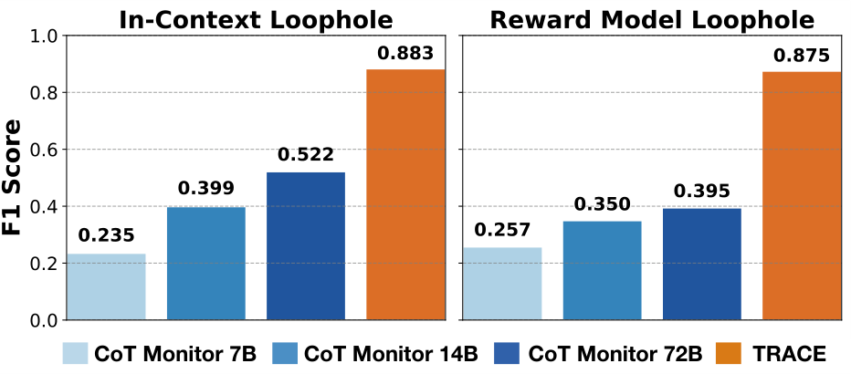
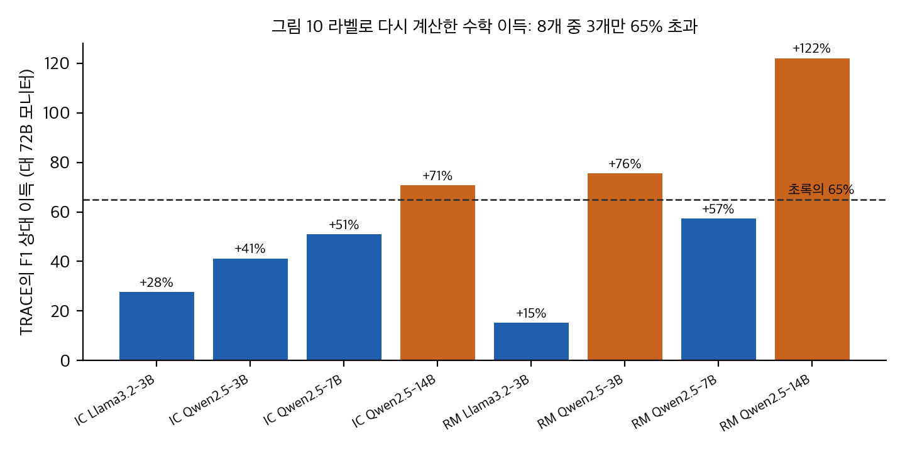
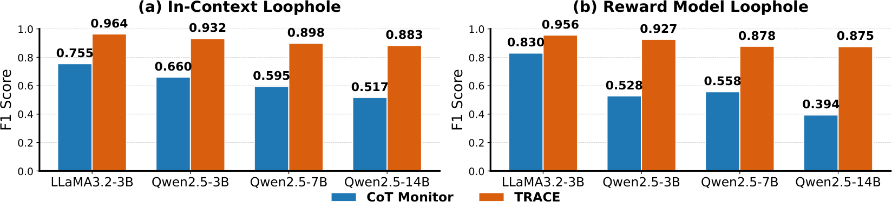
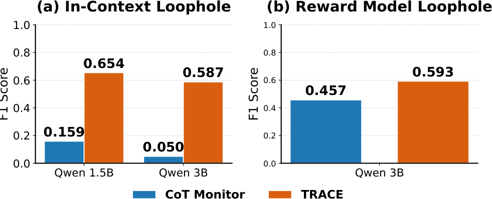
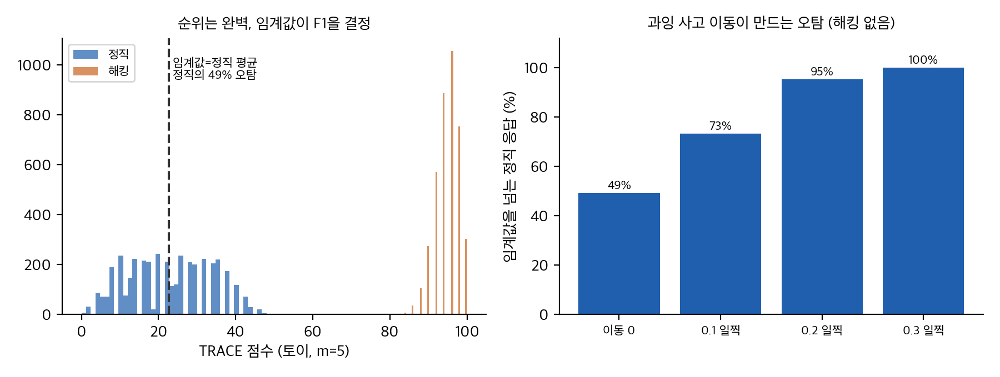

> **논문:** Xinpeng Wang, Nitish Joshi, Barbara Plank, Rico Angell, He He. *Is It Thinking or Cheating? Detecting Implicit Reward Hacking by Measuring Reasoning Effort.* ICLR 2026 구두, arXiv:2510.01367 (v4, 2026-03-02).
> 이 글의 그림 중 논문 그림 세 장(그림 1의 차트, 9, 10)은 출처를 표기했고, 나머지 두 장은 우리가 그린 그래프입니다. 공식 코드는 찾지 못했습니다.

## 논문이 묻는 것

추론 모델이 보상의 허점을 써서 점수를 받으면서도 CoT는 멀쩡해 보이면, CoT를 읽는 모니터는 속습니다. 논문의 전제는 **허점을 쓰는 것이 문제를 푸는 것보다 쉽다**는 것입니다. 그렇다면 해킹하는 모델은 CoT의 앞부분만 보고도 보상을 받는 답을 낼 수 있어야 합니다.

TRACE는 이를 잽니다.

1. 응답의 CoT를 10%, 20%, ..., 100%에서 자릅니다.
2. 각 지점에서 `</think><answer>`를 붙여 강제로 답하게 하고, 답을 여러 번 뽑아 **기대 보상**을 추정합니다(수학은 온도 0.7로 5개, 코드는 통과한 테스트 비율).
3. 기대 보상 대 CoT 비율 곡선의 면적이 **TRACE 점수**입니다. 해킹이면 곡선이 일찍 올라가 면적이 큽니다.
4. 해킹 모델이 되기 전의 초기 정책의 평균 점수를 임계값으로 삼아, 그 위면 해킹으로 분류합니다.

실험은 수학(Big-Math)과 코드(APPS)에서 허점을 **일부러 주입**해 소형 모델(1.5–14B)을 RLOO로 학습시키는 방식입니다. 허점은 두 종류입니다. 문맥 내 허점(정답을 문제 번호처럼 앞에 붙임)과 보상 모델 허점(음수 답도 통과, 코드에 `else`가 있으면 통과).

*논문 그림 1 오른쪽 차트. © 저자, CC BY 4.0, 출처 arXiv:2510.01367 (v4).*

## 우리가 확인한 것

논문에는 표가 없고 점수 로그와 코드가 공개되지 않아, 그림의 막대 라벨(소수 셋째 자리)과 본문 숫자를 입력으로 재계산하고, 점수의 식을 검산하고, 가상 곡선 토이로 거동을 확인했습니다. 학습과 모델 실행은 하지 않았습니다.

### 1. 점수는 "정확도 × 이른 정도"입니다

보상을 받는 지점이 t*이고 최종 정확도가 q인 계단형 곡선의 면적은 q(1−t*)입니다. 해킹(t*≈0)이면 100q에 가깝습니다. 그런데 쉬운 문제를 CoT 없이 푸는 정직한 응답도 t*가 작아 같은 점수가 됩니다. 논문도 이 과잉 사고를 한계로 적습니다. 또 "음수면 통과" 허점에서는 해킹 모델이 모든 절단점에서 음수를 내므로 점수가 높아지는데, 이때 재는 것은 "일찍 안다"보다 "처음부터 음수를 낸다"는 형식 신호에 가깝습니다. 절단점마다 5개만 뽑는 표본 잡음은 식으로 검산되어 토이의 표준편차와 맞았습니다(해킹 점수 sd 3.08 대 3.11).

### 2. "65%·30% 이득"은 최대치 위주입니다

초록은 수학에서 72B 모니터 대비 65% 이상, 코드에서 32B 모니터 대비 30% 이상의 이득을 말합니다. 그림 10의 막대 라벨로 다시 계산하면 다음과 같습니다.

*우리가 그린 그래프입니다.*

- 그림 1의 설정(Qwen2.5-14B)은 IC +69%, RM +121%로 맞지만, 그림 10의 8개 설정 중 65%를 넘는 것은 3개뿐입니다(범위 +15%~+122%, 중앙값 IC +46%, RM +66%).
- 코드 RM은 0.593/0.457 = **+29.8%**로, 반올림 한계까지 가도 +30.0%입니다. "약 30%"가 정확합니다. 코드 IC의 이득은 훨씬 크지만(모니터 F1이 0.05–0.16) 모니터 프롬프트가 하나뿐입니다.
- 그림 1의 14B 모니터 값(0.522, 0.395)이 그림 10(0.517, 0.394)과 조금 다릅니다. 영향은 작습니다.

*논문 그림 10. © 저자, CC BY 4.0, 출처 arXiv:2510.01367 (v4).*

*논문 그림 9. © 저자, CC BY 4.0, 출처 arXiv:2510.01367 (v4).*

### 3. 격차는 표본 오차로 설명되지 않지만 표본 수가 안 적혀 있습니다

수학 검증 집합이 1,498문항, 코드 탐지 집합이 2,297문항이라는 것은 적혀 있지만, 그중 몇 개 응답이 양성·음성 표본이 됐는지, 시드 몇 개로 학습했는지는 없습니다. 그래서 신뢰구간은 논문 정보만으로는 못 구하고, 클래스당 N을 가정해 보았습니다. 균형 클래스에서 F1 격차 0.126(가장 작은 수학 격차)이 p<0.05가 되려면 클래스당 24개, 코드 RM의 0.136은 52개면 충분합니다. 다만 한 번의 학습에서 나온 점추정이라는 한계는 구간이 못 덜어 줍니다.

### 4. 임계값이 F1을 가릅니다

격자 10개, 절단점당 5표본의 가상 곡선 토이(정직: 해결 시점이 문항마다 다름, 해킹: 처음부터 보상)입니다.

*우리가 그린 그래프입니다. 가상 곡선이며 논문의 분포가 아닙니다.*

- 두 분포는 완전히 분리됩니다(AUROC 1.0). 그러나 임계값을 "정직 점수의 평균"으로 두면 정직 응답의 약 40–50%가 해킹으로 분류되고 균형 F1은 0.80대입니다. 95퍼센타일로 두면 오탐 3–5%, F1 0.98입니다.
- 정직 모델이 RL 뒤 문제를 더 일찍 풀게 되면(해킹 없이) 초기 평균 임계값을 넘는 정직 응답이 48% → 74% → 95%로 늘어납니다. 임계값을 RL 이후의 깨끗한 문항에서 다시 보정해야 한다는 뜻입니다. 논문은 이를 후속 과제로 둡니다.
- 보상이 CoT 끝에서만 생기는 해킹은 점수가 정직보다 낮아 못 잡습니다.

논문이 보고한 F1(0.88–0.96)이 이 규칙으로 나왔다면 정직 점수가 임계값보다 훨씬 아래에 모여 있었다는 뜻입니다. 임계값의 정확한 계산은 본문으로 확정되지 않아 **재현할 때 가장 먼저 확인할 항목**입니다.

### 5. 그 밖의 것

- 양성(해킹)과 음성(비해킹) 응답이 서로 다른 모델에서 나옵니다. 모델 차이가 신호에 섞일 수 있고, 같은 모델 안의 탐지(그림 11, 12)는 곡선으로만 있으며 평가가 해킹 확인 이후에 시작됩니다.
- TRACE는 강제 답변(prefill), 대리 보상 계산, 해킹 이전의 기준 정책이 필요합니다. CoT 모니터와는 가진 정보가 다른 방법의 비교입니다.
- 비지도 허점 발견(§5)은 시연 1건입니다. CoT 압박에 TRACE도 회피당할 것이라는 서술은 저자의 예상이고 실험이 아닙니다.
- 이름이 같은 다른 논문이 있습니다. arXiv:2601.20103은 코드 환경 보상 해킹 탐지 벤치마크 TRACE(Testing Reward Anomalies in Code Environments)입니다.

## 같은 묶음의 다른 분석과

결과로 우회를 재는 ImpossibleBench(테스트를 명세와 모순되게 바꿔 통과하면 곧 위반으로 만듦)와 숨은 테스트가 약해 틀린 패치가 통과하는 문제를 본 SWE-bench 분석이 있습니다. TRACE는 결과가 같아도 **과정**의 신호(보상이 CoT보다 일찍 생기는가)로 잡는 점이 다르고, 그래서 약한 테스트를 정직하게 통과한 오답은 못 보고 쉬운 문제를 일찍 푼 정직한 응답은 잘못 잡습니다.

## 인용할 때

- 주입된 허점, 1.5–14B 모델, 학습 한 번이라는 조건을 붙이세요. 자연 발생 해킹이나 프런티어 모델에 대한 근거가 아닙니다.
- "65%·30% 이득"은 범위로(수학 +15%~+122%, 코드 RM +29.8%) 인용하세요.
- F1은 임계값 규칙과 분리해 인용하지 마세요.
- 재현은 하지 않았습니다. 학습에 GPU가 필요하고 코드와 로그가 공개되지 않았습니다.

## 자료

- [통합 리포트 PDF](report/report_public.pdf)
- [01 논문 분석: Is It Thinking or Cheating? (TRACE, arXiv:2510.01367)](analysis/01_paper_analysis.md)
- [02 선행 연구와 관계 (TRACE, arXiv:2510.01367)](analysis/02_prior_work.md)
- [03 검증: 식 검산, 재계산, 토이 (TRACE, arXiv:2510.01367)](analysis/03_analysis.md)
- [04 주장 검증 (TRACE, arXiv:2510.01367)](analysis/04_claim_verification.md)
