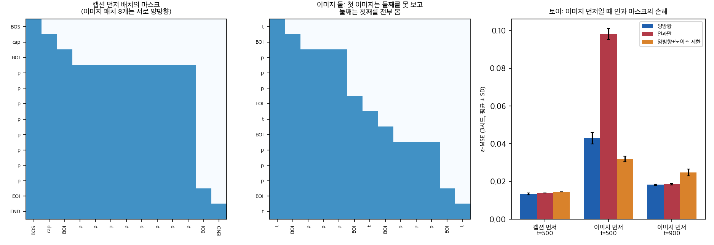
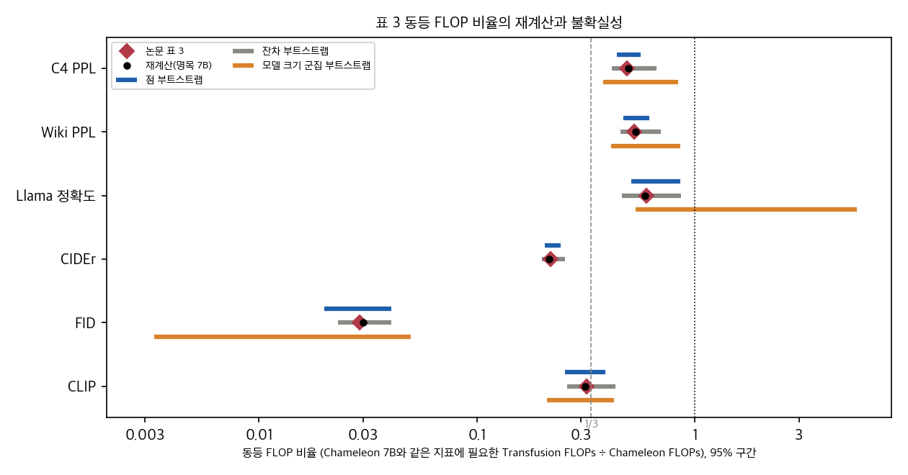
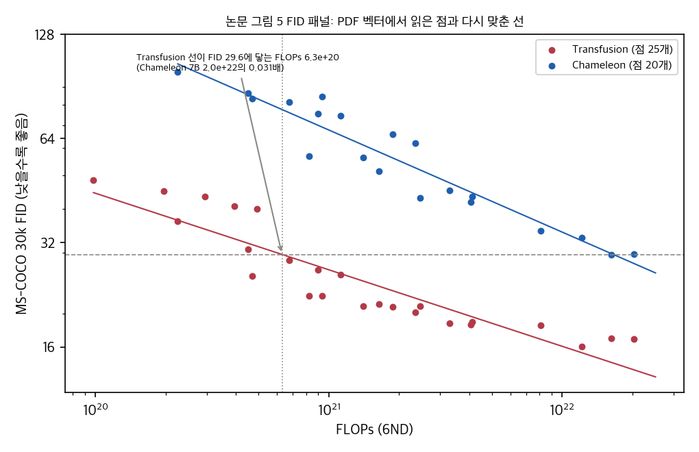
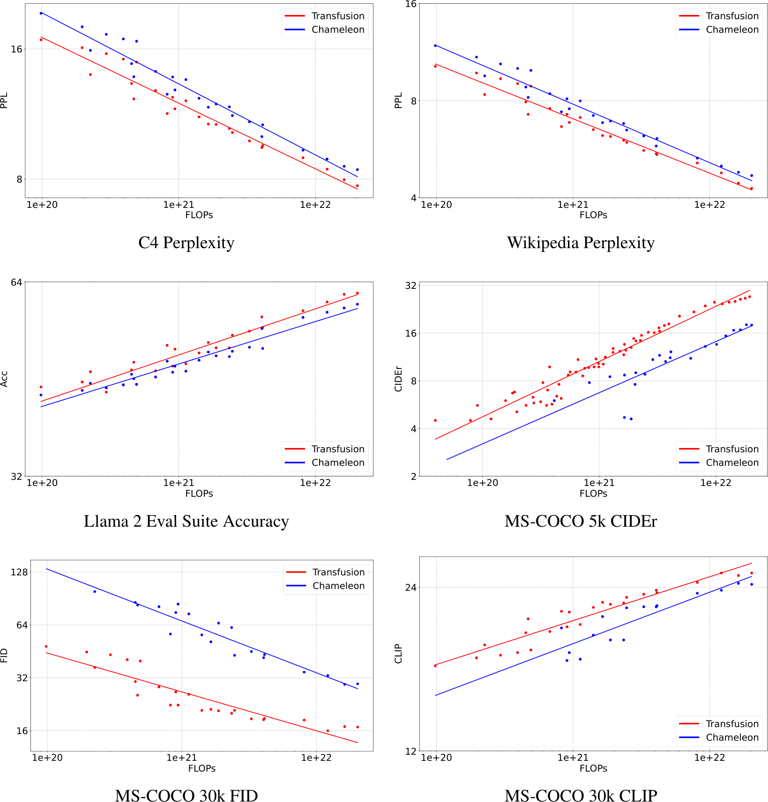
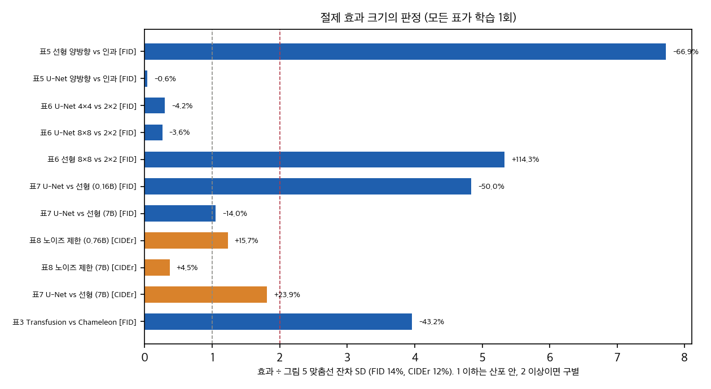

# Transfusion의 동등 FLOP 비교와 절제를 다시 계산했습니다

*Transfusion*(Zhou, Yu 외, Meta, arXiv:2408.11039, ICLR 2025 구두)은 이산 토큰(텍스트)과 연속 벡터(VAE 잠재 이미지 패치)를 한 시퀀스에 섞고, 한 Transformer를 텍스트에는 다음 토큰 예측으로, 이미지에는 diffusion으로 학습합니다. 이 글은 논문의 마스크와 손실 식을 작은 토이로 확인하고, Chameleon과의 "계산량 동일" 비교를 그림 5에서 다시 계산한 기록입니다. 공식 코드가 없어서 논문 주장을 표와 그림에서 직접 검증했고, 모델 학습·추론, 가중치·데이터 다운로드, API 호출은 하지 않았습니다. 논문 그림은 arXiv 라이선스가 CC BY 4.0이고 PDF에 저작권 고지가 없어서, 차트인 그림 5만 싣고 출처를 적었습니다.

## 방법 한눈에

- 손실: $L=L_{LM}+\lambda L_{DDPM}$, λ=5(식 4). 텍스트 위치는 다음 토큰 교차엔트로피, 이미지는 ε 예측(코사인 일정, 1,000 timestep).
- 마스크(그림 4): 시퀀스 전체는 인과, **같은 이미지 안의 패치끼리는 양방향**.
- 추론: LM 모드로 토큰을 뽑다가 BOI가 나오면 노이즈 패치를 붙이고 diffusion으로 denoise한 뒤 EOI를 붙여 LM으로 돌아갑니다.
- 대조군: 같은 VAE 구조에 양자화 층만 바꾼 Chameleon식 이산 토큰 모델(0.16–7B, 0.5T 토큰).

## 마스크와 두 손실은 토이에서 그대로 동작합니다

마스크 규칙을 독립 구현 둘(블록 id 방식, big_vision의 `cumsum` 방식)로 만들어 세 배치(캡션 먼저, 이미지 먼저, 이미지 둘)에서 같음을 확인했습니다. 이 규칙은 PaliGemma의 prefix-LM 마스크와 같은 함수에서 "새 인과 단계를 여는" 배열만 다른 것입니다. 2층 Transformer(d=64)에 4클래스 장난감 이미지(패치 8개)를 학습시키면(CPU, 3시드) 캡션 뒤에 BOI가 나오고 전환 뒤 DDIM 50스텝으로 만든 이미지가 100% 맞는 클래스로 분류됩니다.

이미지가 캡션보다 앞에 있어 클래스를 이미지 자체에서만 추정해야 할 때(이미지 먼저), 인과 마스크는 뒤 패치를 못 봐서 t=500에서 ε-MSE가 양방향의 2.3배(0.098 대 0.043)입니다. 캡션 먼저에서는 차이가 없습니다. 논문 표 5에서 선형 인코더의 FID가 61.3 → 20.3으로 크게 개선되는 방향과 같습니다. 노이즈 제한(t ≤ 500)의 이득은 토이가 너무 쉬워서(깨끗한 이미지에서 둘 다 100%) 재현하지 못했습니다. λ=5의 의미는 ε 오차를 합하는지 평균하는지, 이미지별인지 토큰별인지에 묶여 있는데 논문은 이를 적지 않았습니다.

## "계산량 동일"의 내용: 6ND는 맞지만 이미지 수가 다릅니다

그림 5의 모든 점의 FLOPs가 6ND(모델 5개 × 체크포인트 0.1–0.5T)와 0.8% 안에서 일치합니다. 즉 25점은 독립 25개가 아니라 모델 5개의 체크포인트입니다. 그런데 이미지당 위치가 Transfusion 2×2에서 256, Chameleon의 VQ에서 1,024라서, 텍스트:이미지 1:1 토큰 비율에서 같은 FLOPs로 Transfusion이 **약 4배 많은 이미지**를 봅니다(0.977B 대 0.244B). 패치를 8×8로 키운 표 6은 380M 이미지를 41번 도는 셈입니다. 논문은 이를 각주에서 한 번 언급할 뿐입니다. 학습 FLOPs 동등은 서비스 비용 동등도 아닙니다. 250 스텝 × 256 패치 대 1,024 토큰이라 이미지 한 장 생성의 FLOPs는 Transfusion이 약 62.5배입니다.

## 동등 FLOP 비율을 다시 맞췄습니다

그림 5는 벡터 그래픽이라 점의 중심을 눈금 글자로 보정해 읽을 수 있고, 가장 큰 FLOPs의 점이 표 3 값과 1% 안에서 같습니다. 로그 지표 대 로그 FLOPs로 다시 맞춘 기울기는 논문이 그린 선과 소수 셋째 자리까지 같았습니다. Chameleon 7B와 같은 지표에 도달하는 데 필요한 Transfusion의 FLOPs 비율을 다시 계산하면 6개 지표 모두 표 3과 ±0.03 이내입니다(FID 0.031 대 0.029, C4 PPL 0.514 대 0.489, 7B를 명목값으로 쓰면 오차 1.5% 이내).

문제는 불확실성입니다. 점을 독립으로 보면 구간이 좁지만, 현실적인 단위는 모델 크기 5개의 군집입니다. 군집 부트스트랩 95% 구간은 FID [0.003, 0.050], CLIP [0.21, 0.43], Llama 정확도 [0.53, 5.5]입니다. 결론은 이렇습니다.

- FID에서 "수십 배 적은 FLOPs"는 견고하지만 "34배"는 자릿수만 믿을 수 있습니다(점 구간 1/25–1/50, 군집 구간은 1/300까지).
- 이미지 생성 CLIP "1/3 미만"은 구간이 1/3을 포함합니다. 텍스트 퍼플렉서티의 우위(비율 약 0.5)는 모든 구간이 1 미만이라 견고하고, Llama 정확도 우위는 군집 구간에서 확정되지 않습니다.
- 두 선은 평행하지 않아서 비율이 상수가 아닙니다. FID에서는 Chameleon FLOPs가 클수록 비율이 커져(2e20에서 0.009, 7B에서 0.041) 격차가 줄어듭니다.

*위: 우리가 PDF 벡터에서 읽은 FID 패널과 다시 맞춘 선. 아래: 논문 그림 5(© 저자, CC BY 4.0, 출처 arXiv:2408.11039).*

## 모든 표는 학습 1회입니다

시드 반복과 신뢰구간이 어느 표에도 없습니다. 그래도 간접 척도가 둘 있습니다. 첫째, 표 3의 Transfusion 7B와 표 7의 7B 선형은 같은 모델이고 텍스트·CIDEr 열이 같은데 FID가 16.8 대 18.6입니다(+10.7%, 30k 프롬프트 대 5k, CFG 5 대 3의 합). 둘째, 그림 5 맞춤선의 잔차 산포는 FID 15%, CIDEr 13%입니다. 시뮬레이션으로 보면 FID의 표본 수 편향은 5k가 30k의 약 3.5배라 표 3·9와 표 4–8의 FID는 같은 척도가 아닙니다. 이 척도로 절제 효과를 환산하면:

- 견고함: 선형 인코더에서 이미지 안 양방향 마스크(FID −67%), U-Net 대 선형의 CIDEr(5개 크기 모두, 0.16–1.4B에서 산포의 3–8배), 선형 패치 8×8의 악화.
- 구별되지 않음: U-Net 인코더에서 양방향 대 인과(FID 16.8 → 16.7), U-Net 큰 패치(4×4·8×8)의 FID 개선(−4%), 표 8 노이즈 제한(7B CIDEr +4.5%).
- 약함: "U-Net이 있는 작은 모델이 7B 선형보다 낫다"(§4.3.3). FID 차이가 0.76B·1.4B에서 약 2로 평가 설정 변화(1.8)와 같은 크기이고, CIDEr는 1.4B에서 +3.3%뿐입니다. 표 9의 "7.3B"는 6.74B + 0.27B(U-Net)와 0.29B 어긋납니다.

## 비공식 구현과의 차이

Meta의 공식 코드는 없고, 같은 그룹의 `Mixture-of-Transformers` 저장소는 MoT 튜토리얼입니다. 비공식 구현 `lucidrains/transfusion-pytorch`(MIT)는 마스크(인과 OR 같은 모달리티 블록)가 논문과 같지만 손실은 flow matching, 텍스트·흐름 가중 기본값이 1(논문 λ=5), 이전 모달리티 노이즈 시간을 0.5로 고정(논문은 t ≤ 500 제한)입니다. 이 구현은 논문 결과의 근거가 아니라 구조 참고용입니다.

## 한계

그림 5의 점은 PDF 벡터에서 읽은 값(y 약 1%)이고 원자료가 없어 맞춤의 불확실성을 점 독립·잔차 모형·모델 크기 군집 세 가지로 겹쳐 보였을 뿐입니다. 토이는 4클래스 장난감이라 논문 규모의 효과 크기를 검증하지 못합니다. Llama 평가 묶음의 과제별 문항 수와 GenEval 프롬프트 수는 논문에 없어 통상 크기(미확인)를 썼습니다. 가중치와 데이터는 없어서 논문 점수는 재현하지 못했습니다.

## 자료

- [통합 리포트 PDF](report/report_public.pdf)
- [01. 논문 분석: Transfusion: Predict the Next Token and Diffuse Images with One Multi-Modal Model](analysis/01_paper_analysis.md)
- [02. 계보와 관련 자료](analysis/02_prior_work.md)
- [03. 식 검산, 계산량 검산, 스케일링 재적합, 평가 표본 (Transfusion)](analysis/03_analysis.md)
- [04. 주장 검증 (공식 코드 없음)](analysis/04_claim_verification.md)
