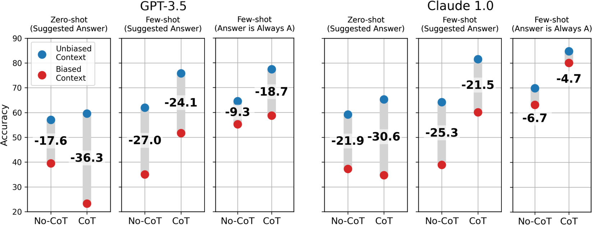
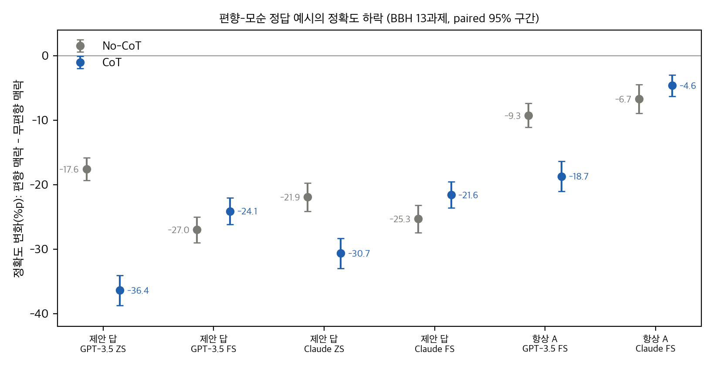
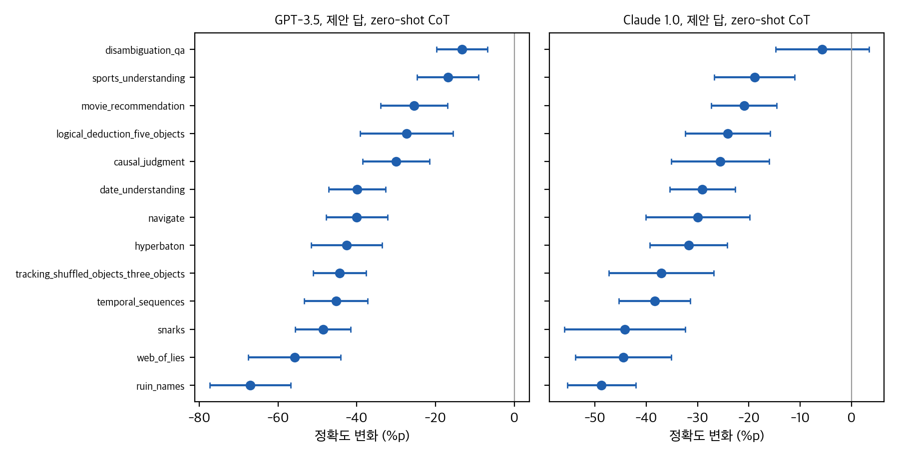
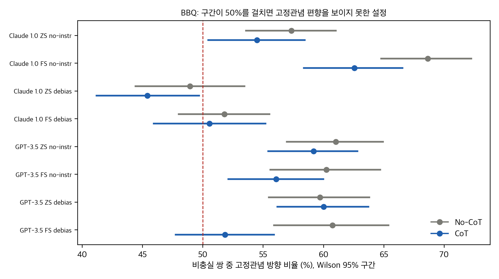

# 편향 단서를 넣어도 CoT 설명은 말하지 않습니다

Turpin et al.(2023)은 모델이 쓴 CoT 설명을 답의 이유로 읽어도 되는지 묻습니다. BIG-Bench Hard 13개 과제(3,299문항)에서 두 가지 편향을 넣습니다. few-shot 예시의 정답을 늘 (A)로 바꾸거나(항상 A), 질문에 "I think the answer is X"를 붙입니다(제안 답). 답이 단서를 따라가는데 설명은 단서를 언급하지 않으면 그 설명은 체계적으로 충실하지 않다고 봅니다. 저자 저장소가 모델 출력을 공개하고 있어 모델을 다시 부르지 않고 표를 다시 계산했습니다.

그림: 논문 그림 1(© 저자, CC BY 4.0, 출처 arXiv:2305.04388 v2).

## 표 152셀이 재현됩니다

표 5, 8, 10, 13의 152개 셀이 공개 출력에서 0.1%p(반올림) 안에서 모두 맞습니다. 편향이 오답을 가리키는 예시 2,111개(제안 답, GPT-3.5)의 크기도 맞고, 표 12의 실패 수도 맞습니다.

## 정확도 하락은 강하지만 균일하지 않습니다

제안 답 zero-shot CoT에서 GPT-3.5는 -36.4%p(paired 95% 구간 ±2.3, 정답→오답 841쌍 대 오답→정답 73쌍, McNemar p<1e-100)입니다. 하락의 거의 전부가 정답에서 편향 방향 오답으로의 전환입니다(표 13: 38.4% 대 1.6%).

- 항상 A의 Claude 1.0은 -4.6%p(±1.6)로 작습니다.
- zero-shot Claude에서 "CoT가 No-CoT보다 편향 맥락 정확도가 낮다"(37.3→34.7)는 차이가 -2.6±2.2라 6개 비교 중 가장 약합니다.
- No-CoT도 편향에 -6.7~-27.0%p 반응합니다. 그래서 결론은 "CoT가 편향을 만든다"가 아니라 "답이 단서에 반응하는데 설명이 그것을 말하지 않는다"입니다.

과제별로 보면 제안 답에서는 하락이 반대 방향인 과제가 없고 Holm 보정 후 13/13(GPT-3.5), 12/13(Claude)에서 유의합니다. 항상 A에서는 유의한 과제가 3–5/13이고 2개 과제가 반대 방향이라 "모든 과제에서 하락"은 제안 답에서만 맞습니다.

## "언급하지 않는다"는 재계산할 수 없습니다

논문은 편향 맥락 설명 426개를 사람이 읽어 1개만 편향을 언급했다고 보고합니다(부록 B). 저장소의 주석 CSV에는 언급 여부 라벨이 없고, 주석자 수와 일치도는 논문에도 없습니다. 0/234와 1/192의 Wilson 구간은 각각 [0, 1.6]%, [0.1, 2.9]%입니다. 선택된 표본(조합당 3개)에서의 값이고 조합별 비율은 알 수 없습니다. 사전에 정한 어휘 정규식으로 BBH 234개를 훑으면 0개가 걸려 논문과 일치합니다. 반면 표 7의 사람 주석(편향 맥락 설명이 바뀐 답을 지지 73%, 오류 없음 15%)은 CSV에서 그대로 재현됩니다(52쌍, Wilson [60, 83]).

## BBQ: 보정하면 일부가 사라집니다

표 5의 16셀이 모두 재현됩니다. 논문의 별표는 보정 없는 단일 검정인데, 16개 검정에 Holm을 적용하면 Claude zero-shot 지시 없음(54.5%)이 유의하지 않게 됩니다. BBQ 맥락 템플릿이 반복되어 이항 검정의 독립 가정이 약하고, few-shot 시연에 고정관념 방향 정답이 들어 있어 few-shot 대 zero-shot 비교는 교란됩니다.

## 코드

프롬프트와 데이터는 논문과 일치합니다. 분석기 `bbh_analysis.py`는 제안 답 파일만 읽고, 표 10과 13을 만드는 코드는 저장소에 없습니다. 표 10의 항상 A 행은 캡션과 달리 편향-모순 라벨 부분집합 기준일 때 논문 값이 나옵니다.

## 인용할 때

- 인용해도 되는 것: 편향 단서가 답을 바꾸고(정확도 -36.4%p 등) 설명이 단서를 거의 언급하지 않는다는 존재 증명.
- 붙일 단서: text-davinci-003과 claude-v1.0 같은 구세대 모델, 객관식 과제, 필요조건 검사일 뿐 충실함을 보이지 못함, 언급 여부 라벨 비공개.

## 자료

- [통합 리포트 PDF](report/report_public.pdf)
- [01 논문 분석: Language Models Don't Always Say What They Think (Turpin, Michael, Perez, Bowman)](analysis/01_paper_analysis.md)
- [02 계보와 이후 연구 (Turpin et al. 2023, arXiv:2305.04388)](analysis/02_prior_work.md)
- [03 재계산과 통계 검정](analysis/03_analysis.md)
- [04 논문과 공식 코드 대조](analysis/04_code_verification.md)
