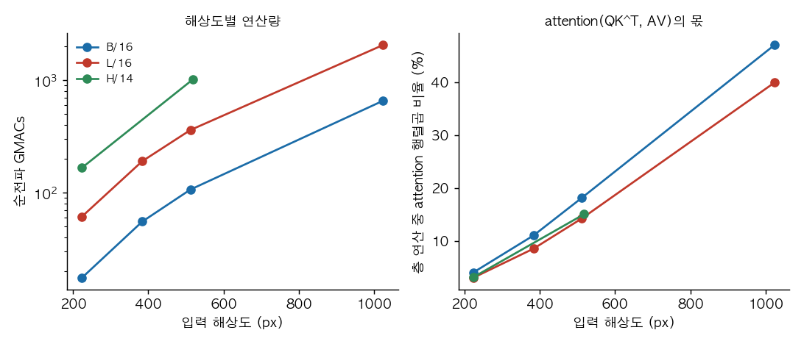
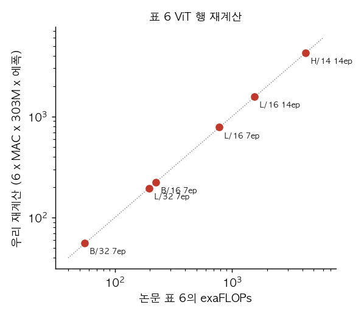
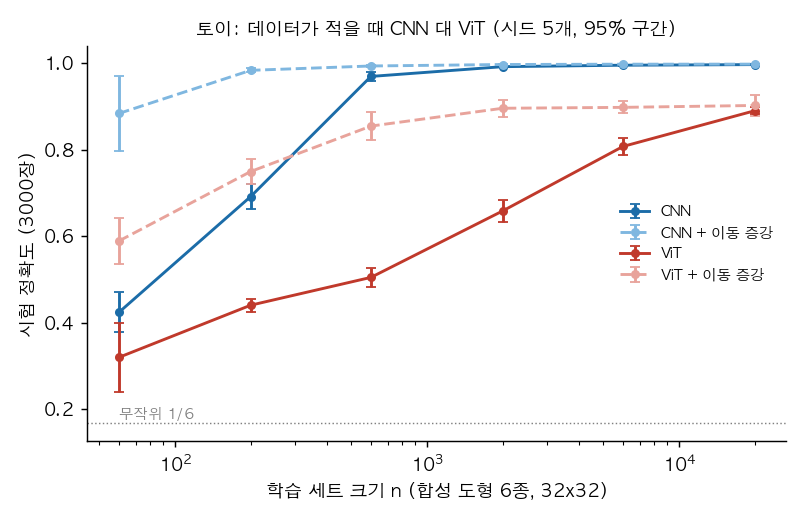

# 이미지를 단어처럼: ViT 직접 짜 보기

ViT(Dosovitskiy 외, ICLR 2021)의 기여는 새 부품이 아니라 "이미지를 16×16 패치로 잘라 선형 사영한 토큰 열 + [CLS] 토큰 + 학습되는 1D 위치 임베딩을 **거의 수정하지 않은 표준 Transformer 인코더**에 넣고, 데이터를 크게 주면 CNN을 넘는다"는 조합입니다. 지금의 비전 인코더(CLIP, SigLIP, DINOv2)와 VLM·VLA의 시각 입력이 모두 이 구조 위에 있습니다. 이 글은 ViT를 PyTorch로 직접 짜서(`minimal_impl.py`, CPU, 테스트 26개) 식과 산술을 검산하고, 이후 문헌이 어떤 주장을 바꿨는지 정리한 기록입니다. 논문 그림은 쓰지 않았고 아래 그래프는 모두 직접 그렸습니다. 공식 코드는 읽기만 했고 실행하지 않았습니다. 이 토이는 논문 재현이 아닙니다.

## 구조 (식 1–4)

이미지 x ∈ R^{H×W×C}를 N = HW/P²개의 평평한 패치로 만들고 학습되는 선형 사영 E로 D차원 토큰을 만듭니다. 앞에 [CLS] 토큰을 붙이고 E_pos ∈ R^{(N+1)×D}를 더한 z₀을 pre-norm 인코더(MSA와 GELU MLP, 식 2·3)에 넣고, 최종 [CLS]에 LN을 한 y가 이미지 표현입니다(식 4). 구현에서 확인한 성질 세 가지입니다.

- **패치 임베딩은 conv와 같습니다.** stride=P인 `Conv2d`와 "패치를 펴서 선형층"이 같은 가중치에서 같은 출력을 냅니다(오차 10⁻⁵ 이내).
- **위치 임베딩이 없으면 모델은 패치의 순서를 못 봅니다.** 위치 임베딩을 끄면 패치를 섞어도 [CLS] 출력이 같고(오차 10⁻⁴ 이내), 켜면 달라집니다. 논문 부록 D.4가 "위치 임베딩 없음"에서만 크게 나빠지는 이유(표 8: 0.614 대 0.640–0.642)입니다.
- **고해상도 미세조정용 위치 임베딩 2D 보간(§3.2)**은 공식 코드의 `scipy.ndimage.zoom(order=1)`과 같은 양 끝점 정렬 bilinear로 짰고, 테스트가 10⁻⁵ 안에서 일치를 확인합니다. 임의 임베딩을 14×14 → 24×24 → 14×14로 왕복하면 상대 RMSE가 0.37인데 부드러운 임베딩은 0.007이라, 보간은 위치 임베딩이 부드러워야 안전합니다(합성 임베딩 기준, 학습된 ViT의 값은 아님).

## 파라미터 수와 연산량

해석식으로 센 파라미터 수가 구현의 `numel` 합과 같습니다. 표 1과는 B/16 86.6M, H/14 632.0M이 맞습니다. **L은 달라서, 표 1의 307M은 ViT-L/16(304.3M)이 아니라 L/32(306.5M)의 개수에 맞습니다**(사전학습 헤드의 은닉층 1.05M을 더해도 305.4M). L/16의 파라미터 수를 인용할 때는 304M을 쓰는 것이 안전합니다.

연산량은 토큰 T=(H/P)(W/P)+1에 대해 선형층 T(4D²+2DM)과 attention 행렬곱 2T²D로 나뉘고, 둘의 비는 **T/(2D+M)**입니다(`torch.utils.flop_counter`와 정확히 일치). 224 해상도에서는 attention이 층 연산의 3–4%뿐이라 연산량이 사실상 토큰 수에 선형이고, B/16은 4608 토큰(약 1086 px)이 되어야 attention과 선형층이 같아집니다.

논문 표 6의 exaFLOPs는 부록이 계산법을 적지 않는데, **6 × MAC × 303M(JFT 장수) × 에폭** 식이 ViT 6개 행을 0.25% 안에서 맞춥니다(B/32만 +2.0%, 표의 55가 정수 반올림). 식은 우리가 맞춰 본 것이고 저자가 확인한 것은 아닙니다. 이 표로 §4.4의 "같은 성능에 연산 2–4배 적다"를 다시 따져 보면(ResNet 7점의 효율 경계 보간) 5개 데이터셋 평균에서 2.8–3.0배(B/32, B/16), ImageNet 하나로는 1.8–2.3배입니다. JFT 7–14 에폭, BiT식 ResNet 한 레시피 안의 값입니다.

## 토이: 데이터가 적을 때 ViT는 불리한가

합성 도형 6종(위치가 무작위인 방해 요인)으로 0.1M 파라미터 CNN과 ViT를 학습 세트 크기 60–20,000장, 시드 5개로 비교했습니다. 같은 optimizer와 하이퍼파라미터, 2000 스텝입니다.

- 증강이 없으면 모든 n에서 **CNN이 앞서고** 격차는 n=600에서 46.5 ± 1.5%p로 최대, n=20000에서 10.7 ± 0.8%p로 줄어듭니다. **ViT가 CNN을 넘는 교차는 이 범위에서 없었습니다.** 논문의 교차(JFT 90M 이상)는 범위 밖이라 확인되지 않았고, "격차가 줄어든다"만 확인됩니다.
- ±4픽셀 이동 증강은 ViT에 +24~+35%p(n=200–2000)를 주어 격차의 약 70%를 메웁니다(n=600에서 46.5 → 13.9%p). 위치 불변성을 데이터로 주입하는 효과입니다. 증강이 있어도 격차는 약 10%p 남았습니다.
- 단서: ViT는 큰 n에서 학습이 덜 끝났고(학습 정확도 94.5%, n=20000) 하이퍼파라미터를 모델별로 조정하지 않아, 구조 효과와 레시피 효과가 섞여 있습니다.

## 이후 문헌이 바꾼 것

초록과 본문(arXiv API, PDF)으로 확인한 요약입니다. 이후 논문의 실험은 재현하지 않았습니다.

- **데이터가 적으면 못한다 (수정).** DeiT는 ImageNet-1k만으로 ViT-B가 증류 없이 81.8%(224), 83.1%(384). Better plain ViT는 ViT-S/16을 표준 증강만으로 90 에폭 76.5%, 300 에폭 80.0%에 올렸고, 증강(RandAugment+Mixup)을 빼면 73.6/73.7/73.7%(−2.9~−6.3%p)로 증강이 가장 큰 항목입니다. ResNet-50도 새 레시피로 80.4%가 되었습니다(ResNet strikes back). AugReg는 증강과 연산으로 ImageNet-21k 모델이 JFT-300M 모델과 같거나 앞선다고 보이면서, 아주 작은 데이터에서는 성립하지 않는다고 적습니다.
- **[CLS]와 GAP는 비슷하다 (수정).** 원전은 JFT 5-shot에서 학습률을 따로 맞추면 비슷하다고 했지만, Better plain ViT는 ImageNet-1k 처음부터 학습에서 GAP를 [CLS]로 바꾸면 −1.5/−1.6/−1.8%p(90/150/300 에폭)입니다.
- **위치 임베딩 차이는 작다 (조건부).** 같은 노트에서 2D sin-cos를 학습 1D로 바꾸면 −1.5/−0.5/−0.4%p로, 짧게 학습할수록 차이가 보입니다. 시드나 구간은 보고되지 않았습니다.
- **마스크 패치 자기지도는 지도에 4% 뒤진다 (수정).** MAE는 ViT-H로 ImageNet-1K만으로 87.8%를 보고합니다(모델 크기가 달라 직접 비교는 아님).
- **원전이 몰랐던 문제: 고노름 토큰.** Darcet 외(ICLR 2024)는 큰 ViT(DeiT-III, OpenCLIP, DINOv2)에서 정보량이 낮은 배경 패치 약 2%에 출력 노름이 약 10배인 토큰이 생기고(ViT-L 이상, 학습의 3분의 1 이후, 중간층부터), 추가 토큰(register)을 주면 사라진다고 보고했습니다. 이는 LLM의 massive activation과 attention sink와 닮았지만(소수 토큰에 큰 노름과 attention이 몰림, 큰 모델과 긴 학습에서만 나타남, 추가 토큰이나 정규화로 사라짐) 위치가 고정이 아니라 내용 기반이고, 같은 메커니즘인지는 검증되지 않았습니다.

## 공식 코드와의 차이

`google-research/vision_transformer`(Apache-2.0)는 미세조정·추론 코드이고 JFT 사전학습 코드는 없습니다. 패치 임베딩은 conv 한 층(주석: "it's the same"), [CLS]는 0 초기화, 위치 임베딩은 N(0, 0.02²), 마지막 LN은 모든 토큰에 적용(식 4와 동치), 헤드는 항상 0 초기화입니다. 보간은 `scipy.ndimage.zoom(order=1)`이고 정사각 격자만 지원합니다. GAP 설정이 별도로 있고 `representation_size`(tanh 은닉층)는 공개 설정에서 모두 None입니다. MLP는 Xavier uniform 초기화(우리는 torch 기본)입니다.

## 확인하지 못한 것

학습된 ViT의 성질(attention 거리, 위치 임베딩 유사도, 고노름 토큰)과 표 2·6의 ResNet 행, 그림 4·8은 사전학습 가중치와 대규모 학습이 필요해 하지 않았습니다. 토이는 0.14M 파라미터, 32×32, 최대 20,000장이고 위치가 방해 요인인 합성 과제라 CNN에 유리하게 설계되었습니다.

## 자료

- [최소 구현](analysis/minimal_impl.py)
- [01. 논문 분석: An Image is Worth 16x16 Words (ViT)](analysis/01_paper_analysis.md)
- [02. 계보: ViT 이전과 이후](analysis/02_prior_work.md)
- [03. 식 검산, 최소 구현, 토이 실험](analysis/03_analysis.md)
- [04. 주장 검증: 이후 문헌이 확인·수정·반박한 것 (C1–C9)과 공식 코드 대조 (D1–D8)](analysis/04_claim_verification.md)
