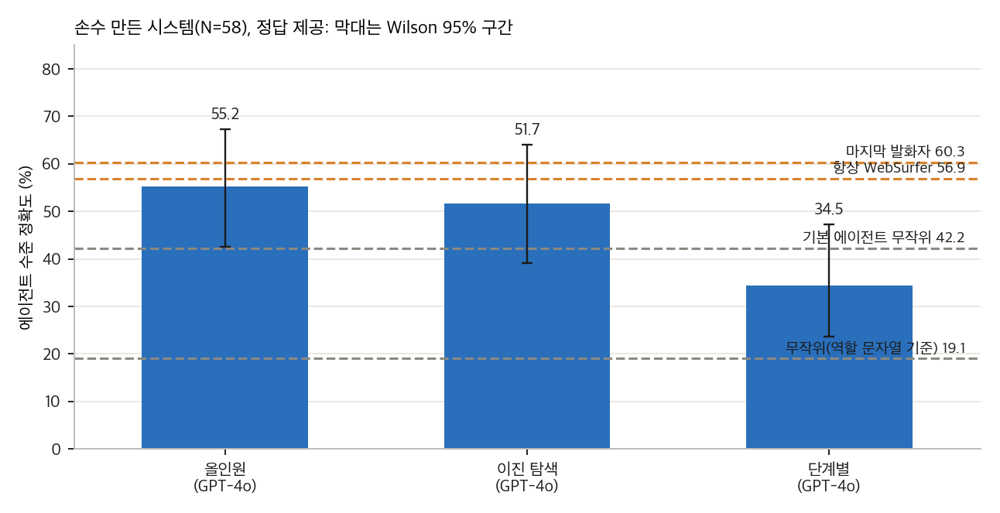
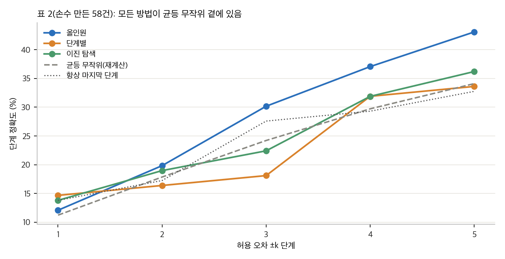
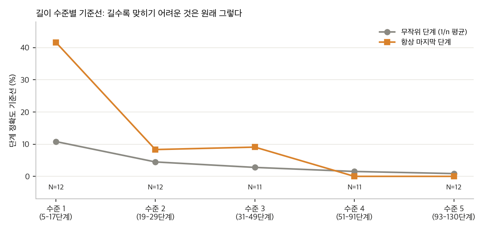

# Who&When: 실패 귀인 정확도 55%와 5%는 단순 규칙과 얼마나 다른가

다중 에이전트 시스템이 실패하면 **어느 에이전트가, 어느 단계에서** 잘못했는지 찾아야 합니다. Who&When(Zhang et al., ICML 2025 스포트라이트)는 이 작업을 자동화하는 문제를 정식화하고 벤치마크를 만들었습니다. 알고리즘으로 생성한 126건(GAIA 98, AssistantBench 28)과 손수 만든 시스템(Magentic-One) 58건, 합계 184건입니다. 세 가지 LLM 판정 방법(all-at-once, step-by-step, binary search)의 GPT-4o 결과는 에이전트 수준 최대 약 55%, 단계 수준 5–25%입니다.

## 공개 데이터로 다시 계산

공식 저장소의 JSON 184개로 궤적 통계와 기준선을 다시 계산했습니다. 모델은 호출하지 않았고, 논문 표 값을 옮겨 적어 검정했습니다.

- **표 1의 Random 행은 두 값(12.00, 19.06)이 자리가 바뀐 것으로 보입니다.** 균등 무작위의 기대 정확도를 계산하면 알고리즘 생성의 단계 수준이 12.00, 손수 만든 에이전트 수준이 19.06입니다. 네 값이 같은 정의로 소수 둘째 자리까지 맞고, 두 값만 자리가 다릅니다. 초록의 "일부 방법은 무작위보다 낮다"는 이 배치에 기댑니다. 바로잡으면 all-at-once 단계 수준은 무작위와 같은 수준입니다.
- **에이전트 수준 정확도는 단순 규칙과 구분되지 않습니다.** 손수 만든 58건에서 "마지막 발화자"는 60.3%, "항상 WebSurfer"는 56.9%이고 GPT-4o all-at-once는 55.2%(95% 구간 42.5–67.3%)입니다. 논문의 무작위 기준선 19.06은 `human`과 `Orchestrator (thought)` 같은 역할 문자열 변형까지 별개 에이전트로 센 값입니다. 기본 에이전트 기준 무작위는 42.2%입니다.
- **단계 수준 5–9%는 신호로 보기 어렵습니다.** 손수 만든 58건에서 "항상 마지막 단계"가 12.1%입니다. 허용 오차를 두는 표 2에서도 세 방법 모두 균등 무작위 곁에 있습니다(p > 0.09).

## 방법 간 차이는 일부만 확인됩니다

비짝 Fisher 검정(개별 예측이 공개되지 않아 짝지은 검정은 불가)입니다.

| 비교 | 정확도(%) | p |
|---|---|---:|
| 손수 만든, 에이전트, all-at-once 대 step-by-step | 55.2 대 34.5 | 0.040 |
| 알고리즘 생성, 에이전트, 같은 비교 | 54.3 대 35.2 | 0.0035 |
| 알고리즘 생성, 단계, all-at-once 대 step-by-step (정답 제공) | 12.5 대 25.5 | 0.016 |
| 손수 만든, 단계, 모든 방법 쌍 | 3.5–8.8 | ≥ 0.44 |

에이전트 수준에서 all-at-once가 높다는 결론은 두 부분집합에서 받쳐집니다. step-by-step이 단계 수준에서 가장 좋다는 결론은 알고리즘 생성의 정답 제공 설정에서만 받쳐집니다. 손수 만든 58건에서는 맞힌 수가 3–5개라 방향을 말할 수 없습니다.

## 표 내부 불일치

- 표 3의 에이전트 수준 값(57.02, 35.96)이 표 1·4에서 풀링한 값(54.31, 33.62)과 다릅니다.
- 손수 만든 단계 수준 셀 일부는 k/57로, 나머지는 k/58로 나뉩니다. 알고리즘 생성 셀은 k/126으로 설명되지 않습니다.
- 초록의 53.5%와 14.2%는 서로 다른 방법(all-at-once, step-by-step)의 부분집합 평균(가중 없음)입니다.
- 길이 수준별 하락(그림 4)은 수준당 표본이 11–12건이고 무작위 기준선 자체가 10.8%에서 0.9%로 같이 떨어집니다.

## 공식 코드

코드는 실행하지 않고 읽었습니다.

- 평가기가 **부분 문자열 일치**(`actual_step in predicted_step`)여서 정답 `1`이 예측 `10`, `21` 등에도 맞습니다. 손수 만든 58건에서 무작위 예측의 기대 단계 정확도가 4.16%에서 8.89%로 부풀려집니다. 논문 수치가 이 코드로 나왔는지는 알 수 없습니다. 상위 저장소(ag2ai)는 이를 정확 일치로 고쳤습니다.
- "정답 없음" 설정, 혼합 방법, 추론 프롬프트 절제는 공개 코드에 없습니다. 모든 프롬프트가 정답을 포함합니다.
- Hugging Face 데이터는 GitHub 데이터와 키 이름(`groundtruth`)과 라벨 철자(`Websurfer` 2건)가 다릅니다.

## 라벨의 성격

라벨은 사람 판단입니다(논문 식 4의 반사실 정의는 라벨에 적용되지 않음). 이후 연구 DoVer(arXiv:2512.06749)는 손수 만든 부분집합의 GAIA 29건 중 14건에서 정답 라벨이 불확실하다고 보고하고, 같은 모델의 단계 정확도가 로그 형식(단계 번호 명시)만으로 6%에서 21%까지 달라진다고 보고합니다(해당 논문의 수치이며 여기서 재현하지 않았습니다).

## 인용할 때

- 데이터셋 구성과 방법 간 방향(에이전트 수준 all-at-once 우위)은 인용해도 됩니다.
- 표 1의 Random 행 배치, "일부 방법은 무작위보다 낮다", 초록 53.5/14.2를 한 방법의 성능으로 읽는 것은 피하세요.
- 정확도를 인용할 때는 단순 규칙 기준선(마지막 발화자, 항상 마지막 단계)과 함께 쓰세요.
- 단일 실행이고 시드·분산이 없으며 개별 예측이 공개되지 않았습니다.

재계산 스크립트와 결과는 이 글과 같이 공개한 분석 노트(`analysis/`)에 있습니다.

## 자료

- [통합 리포트 PDF](report/report_public.pdf)
- [01. 논문 분석: Which Agent Causes Task Failures and When? (Who&When)](analysis/01_paper_analysis.md)
- [02. 계보와 관계: Who&When](analysis/02_prior_work.md)
- [03. 재계산과 검정: Who&When](analysis/03_analysis.md)
- [04. 공식 코드와 데이터 정적 대조: Who&When](analysis/04_code_verification.md)
